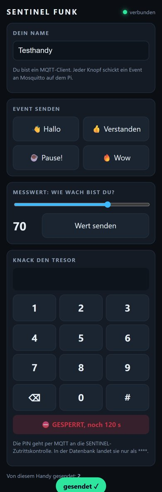
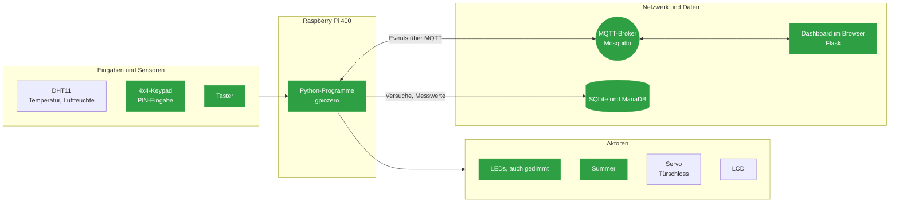
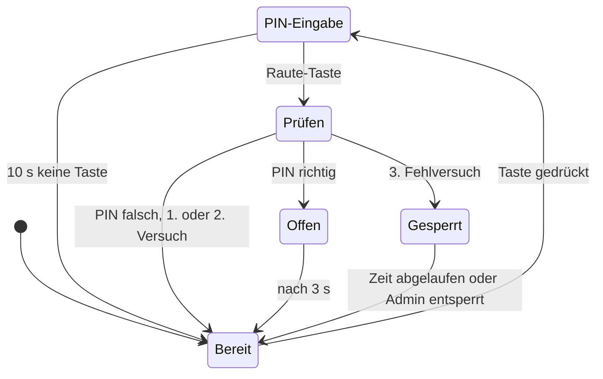
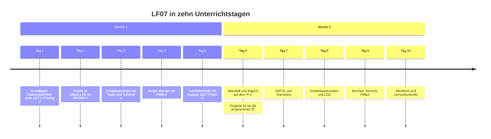
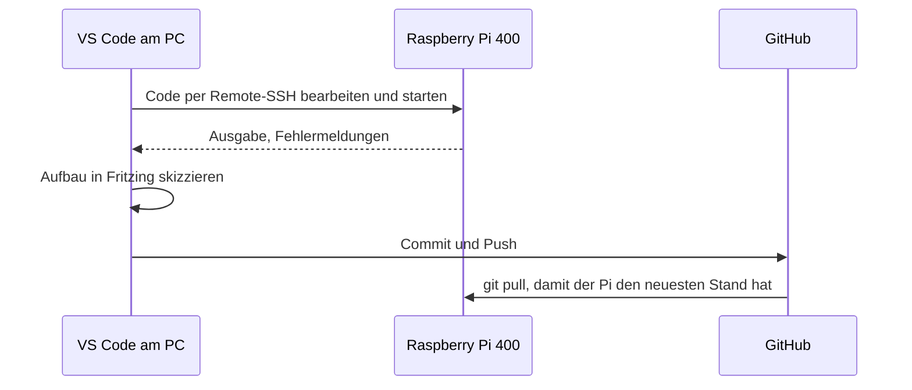

<a id="top"></a>

<p align="center">
  <a href="README.md"></a>
  <a href="README.de.md"></a>
</p>

<p align="center">
  
</p>

<p align="center">
  
  
  
  
  
  
</p>

<p align="center">
  <b>Sensoren messen. Software entscheidet. Aktoren handeln.</b><br>
  Praxisprojekte aus Lernfeld 7 meiner Umschulung zum Fachinformatiker für Systemintegration.
</p>

<p align="center">
  
</p>

<p align="center">
  <a href="#highlights">Highlights</a> ·
  <a href="#projekte">Projekte</a> ·
  <a href="#übungen">Übungen</a> ·
  <a href="#architektur">Architektur</a> ·
  <a href="#lerntagebuch">Lerntagebuch</a> ·
  <a href="#schnellstart">Schnellstart</a> ·
  <a href="#so-arbeite-ich">So arbeite ich</a> ·
  <a href="#sicherheit">Sicherheit</a>
</p>

---

> [!NOTE]
> Das ist ein Lern-Repo. Ich bin Umschüler und kein Profi-Entwickler. Jede Code-Zeile hat einen deutschen Kommentar, damit ich sie selbst erklären kann und andere sie nachvollziehen können. Das Repo wächst mit jedem Unterrichtstag.

## Auf einen Blick

<table>
<tr>
<td width="50%" valign="top">

**Was ist ein cyber-physisches System?**

Ein cyber-physisches System (CPS) verbindet Software mit der echten Welt. Ein Sensor misst etwas, ein Programm entscheidet, und ein Aktor tut etwas. Beispiel: Jemand tippt am Keypad eine falsche PIN, das Programm zählt mit, und nach dem dritten Fehler geht eine rote Lampe an. Der Raspberry Pi ist das Gehirn, die GPIO-Pins sind seine Hände.

**Was passiert hier?**

Im Lernfeld 7 entsteht Schritt für Schritt SENTINEL, ein kleines Sicherheitssystem mit PIN-Zutrittskontrolle, Umweltüberwachung, Datenbank und Kundenabnahme. Dazu kommen Übungen aus dem Unterricht. Alles läuft auf meinem eigenen Raspberry Pi 400 und ist dort getestet.

</td>
<td width="50%" valign="top">


<sub>Live-Board aus der MQTT-Übung von Tag 5: Handys und Pi senden Events an Mosquitto, ein Logger schreibt sie in SQLite.</sub>

</td>
</tr>
</table>

## Highlights

| | Was | Warum es spannend ist |
|---|---|---|
|  | [MQTT-Funk](uebungen/tag05-mqtt/) | Die ganze Klasse wird per QR-Code zum MQTT-Client. Jedes Event landet mit Zeit in einer SQLite-Datenbank und fliegt live über ein Board am Beamer. |
|  | [Zutrittskontrolle](uebungen/tag05-zutrittskontrolle/) | PIN am 4x4-Keypad, Sperre nach drei Fehlversuchen, die auch einen Neustart übersteht. PINs liegen nur als Hash mit Salt in der Datenbank. |
|  | [Ampel dimmen](uebungen/tag04-ampel-dimmen/) | Eine LED kann nur an oder aus. Mit PWM leuchtet sie trotzdem mit 60 % oder 20 %. |

## Projekte

Die zehn SENTINEL-Projekte aus der Agenda des Lernfelds.

| Nr. | Projekt | Was es macht | Schwerpunkt | Status |
|:-:|---|---|---|:-:|
| 01 | [SENTINEL Projektstart](projekte/01-sentinel-projektstart/) | Schaltet eine Status-LED sicher über einen GPIO-Pin | Vorwiderstand, GPIO-Ausgang | ✅ |
| 02 | [Lokale Materialstation](projekte/02-lokale-materialstation/) | Erfasst Entnahmen per Taster, als Polling und als Event | Pull-up, Entprellen, Events | 🟡 |
| 03 | [Vernetzte Materialstation](projekte/03-vernetzte-materialstation/) | Sendet jede Entnahme als MQTT-Nachricht nach Vertrag, Leitstelle prüft | MQTT, JSON, Last Will | 🟡 |
| 04 | [Sicherheitsmodul Klimaprüfraum](projekte/04-sicherheitsmodul-klimapruefraum/) | Alarmiert genau einmal, wenn sich 15 s niemand bewegt | Zustandslogik, Countdown | 🟡 |
| 05 | [Lokale Zutrittskontrolle](projekte/05-lokale-zutrittskontrolle/) | Öffnet per Servo SG90 nach der richtigen PIN | Keypad, PWM, Servo | 🟡 |
| 06 | [Dynamische Zutrittskontrolle](projekte/06-dynamische-zutrittskontrolle/) | Prüft PINs gegen MariaDB, fail closed | MariaDB, Argon2, Minimalrechte | 🟡 |
| 07 | Umweltüberwachung | Protokolliert Klimadaten und reagiert auf Grenzwerte | DHT11, Hysterese | ⬜ |
| 08 | Gesicherte Transportbox | Verfolgt den Zustand der Box und meldet ihn | Zustandsautomat, LCD | ⬜ |
| 09 | SENTINEL Release Readiness | Testet das Gesamtsystem und bewertet Risiken | Systemtest, FMEA | ⬜ |
| 10 | SENTINEL Kundenabnahme | Übergibt das System an den "Kunden" | Abnahme, Präsentation | ⬜ |

<sub>⬜ offen · 🟡 Code fertig und automatisch getestet, Aufbau am Pi offen · ✅ fertig und am Pi getestet</sub>

Ab Projekt 02 teilen sich alle Projekte einen Aufbau und einen [zentralen Pinplan](projekte/README.de.md#zentraler-pinplan) für Keypad, Servo und Ampel. Gemeinsame Bausteine wie der MQTT-Vertrag, das Keypad und die Servo-Tür liegen in [`projekte/gemeinsam/`](projekte/gemeinsam/). Alle automatischen Tests laufen mit `bash projekte/alle_tests.sh`.

## Übungen

Aufgaben aus dem Unterricht und dem Raspberry-Pi-Handbuch. Sie bauen die Technik auf, die SENTINEL später braucht, und zählen in der Fortschrittsanzeige mit.

| Tag | Übung | Was sie macht | Schwerpunkt | Status |
|:-:|---|---|---|:-:|
| 03 | [Fußgängerampel](uebungen/tag03-fussgaengerampel/) | Auto- und Fußgängerampel mit Anforderungstaster und Ticksignal für blinde Menschen | Pull-up, Entprellen, Event, PNP-Transistor | ✅ |
| 04 | [Ampel dimmen](uebungen/tag04-ampel-dimmen/) | Lässt die Ampel in drei Stufen leuchten: rot 100 %, gelb 60 %, grün 20 % | PWM, Tastgrad, PWMLED | ✅ |
| 05 | [Zutrittskontrolle](uebungen/tag05-zutrittskontrolle/) | PIN am 4x4-Keypad, Sperre nach 3 Fehlversuchen, Protokoll in SQLite, Live-Dashboard | Matrix-Keypad, SQLite, Hash mit Salt, Flask | 🟡 |
| 05 | [MQTT-Funk](uebungen/tag05-mqtt/) | Keypad, Handys und Notebook senden Events an Mosquitto, ein Subscriber schreibt Wert und Zeit in SQLite | MQTT, Publish/Subscribe, WebSocket, SQLite | ✅ |
| 08 | [MQTT-Funk absichern](uebungen/tag05-mqtt/#absicherung-mit-env-envpassword-und-gitignore-tag-8) | Login und Rechte pro Rolle für Mosquitto, Einstellungen in `.env`, Passwörter in `.env.password`, `.gitignore` und Commit-Wächter halten sie aus GitHub heraus, Angriffstest | .env, ACL, .gitignore, Git-Hook | ✅ |

Die Zutrittskontrolle steht auf 🟡, weil die Testtabelle am Pi noch nicht vollständig abgehakt ist. Sie ist die Grundlage für Projekt 05 und 06.

## Eigenprojekt

| | Projekt | Was es macht | Technik |
|---|---|---|---|
|  | [Telemetrie-Labor](eigenprojekt/telemetrie-labor/) | Der Pi wertet iRacing-Telemetrie (`.ibt`) im Browser aus: Runden finden und prüfen, Streckenkarte aus GPS, zwei Runden mit Zeitabstand an jeder Stelle vergleichen. Reine Software, keine Bauteile | Binärformat, numpy memmap, SQLite, Flask-REST-API, Canvas, uPlot, systemd, Login per `.env.password` |

## Architektur

Das Zielbild für SENTINEL. Grün ist in Projekten oder Übungen schon umgesetzt.



<details>
<summary><b>Beispiel: Zutrittskontrolle als Zustandsautomat</b></summary>

So verhält sich das PIN-Schloss aus der Übung von Tag 5. Wer die Zustände zuerst aufzeichnet, schreibt und testet den Code danach deutlich leichter.



</details>

<p align="right"><a href="#top">nach oben ↑</a></p>

## Lerntagebuch

Was an welchem Tag entstanden ist. Ab Tag 7 ist es der Plan laut Agenda.



### Was ich bisher kann

- [x] LEDs, Taster, Summer und ein 4x4-Keypad sicher an den GPIO-Header anschließen
- [x] Eingänge mit Pull-up oder Pull-down und Entprellen zuverlässig einlesen
- [x] Eine LED per PWM dimmen
- [x] Geräte per MQTT verbinden (Publisher, Broker, Subscriber)
- [x] Daten und gehashte PINs in einer SQLite-Datenbank speichern
- [x] PINs mit Argon2 in MariaDB speichern, mit Minimalrechten und fail closed
- [ ] Sensoren wie den DHT11 auslesen und auf Grenzwerte reagieren
- [ ] Risiken mit Bedrohungsanalyse und FMEA bewerten
- [ ] Ein System beim Kunden präsentieren und übergeben

<p align="right"><a href="#top">nach oben ↑</a></p>

## Hardware

| Teil | Details |
|---|---|
| Raspberry Pi 400 | Rechner in der Tastatur, Broadcom BCM2711 mit 4 Kernen (1,8 GHz), 4 GB RAM, WLAN, Gigabit-Ethernet, 40-poliger GPIO-Header an der Rückseite |
| Bausatz | Miuzei Ultimate Starter Kit: Steckbrett, Jumperkabel, LEDs, Widerstände (220 Ω, 1 kΩ, 10 kΩ), Taster, aktiver Summer, PNP-Transistor S8550, 4x4-Keypad |
| Werkzeuge | VS Code mit Remote-SSH, Fritzing für Steckplatinen, Git und GitHub |

> [!TIP]
> Im Terminal des Pi `pinout` eingeben. Der Befehl zeigt eine Karte aller 40 GPIO-Pins, das spart viel Abzählen.

## Aufbau des Repos

Jedes Projekt und jede Übung hat denselben Aufbau. So findet man sich überall gleich zurecht.

```text
.
├── projekte/                       SENTINEL-Projekte 01 bis 10
│   ├── 01-sentinel-projektstart/
│   │   ├── README.md, README.de.md Beschreibung, Pinbelegung, Tests
│   │   ├── main.py                 kommentierter Code
│   │   └── schaltplan/             Fritzing-Datei (.fzz) und Bilder
│   ├── 02- bis 06-.../             Code, Tests, README je Projekt
│   ├── gemeinsam/                  Pinplan, MQTT-Vertrag, Keypad, Servo-Tür
│   └── alle_tests.sh               alle automatischen Tests
├── uebungen/                       Übungen aus Unterricht und Handbuch
│   ├── tag03-fussgaengerampel/
│   ├── tag04-ampel-dimmen/
│   ├── tag05-zutrittskontrolle/    mit Dashboard und Tests
│   └── tag05-mqtt/                 mit Live-Board und Tests
├── eigenprojekt/telemetrie-labor/  iRacing-Telemetrie im Browser auswerten
├── docs/                           Banner, Badges
├── .github/vorlagen/               README-Vorlagen für neue Projekte
├── requirements.txt                Python-Pakete
└── LICENSE                         MIT-Lizenz
```

## Schnellstart

```bash
# Repo auf den Pi holen
git clone https://github.com/philmay1/lf07-cyber-physische-systeme.git
cd lf07-cyber-physische-systeme

# Pakete installieren (gpiozero ist auf Raspberry Pi OS schon dabei)
python3 -m venv --system-site-packages .venv
source .venv/bin/activate
pip install -r requirements.txt

# Ein Beispiel starten, zum Beispiel die Fußgängerampel
python3 uebungen/tag03-fussgaengerampel/ampel.py
```

Wie jede einzelne Übung gestartet und getestet wird, steht in ihrer eigenen README.

## So arbeite ich



- **Erst planen, dann bauen:** Zu jeder Schaltung gibt es eine Fritzing-Skizze und eine Pinbelegung, bevor etwas gesteckt wird.
- **Kommentare:** Jede Zeile Code ist auf Deutsch kommentiert.
- **Tests:** Jede README hat eine Testtabelle. Die größeren Übungen haben zusätzlich automatische Tests mit simulierten Pins (`test_zutritt.py`, `test_funk.py`), die ohne Hardware laufen.
- **Commits:** Kurze Nachrichten nach dem Muster `feat(uebungen): ...` für Neues und `docs(...)` für Texte.

## Sicherheit

> [!WARNING]
> Die GPIO-Pins arbeiten mit 3,3 V. Wer 5 V auf einen Eingang legt, kann den Pi zerstören. Jede LED braucht einen Vorwiderstand, und beim Umstecken ist der Pi vom Strom getrennt.

> [!IMPORTANT]
> Passwörter und PINs kommen nie in den Code. Die Datenbanken (`*.db`) schließt `.gitignore` vom Repo aus. PINs speichere ich nur als Hash mit Salt (PBKDF2-SHA256), in Projekt 06 kommt Argon2 dazu. Broker und Dashboards laufen ohne Anmeldung und gehören deshalb nur ins Heimnetz oder Schulnetz, nicht ins Internet.

## Über mich

Ich mache eine Umschulung zum Fachinformatiker für Systemintegration. In diesem Repo dokumentiere ich, was ich in Lernfeld 7 praktisch umgesetzt habe: von der ersten LED bis zur vernetzten Zutrittskontrolle.

## Lizenz

Der Code steht unter der [MIT-Lizenz](LICENSE). Du darfst ihn nutzen und verändern, solange der Lizenzhinweis erhalten bleibt.

<p align="right"><a href="#top">nach oben ↑</a></p>
