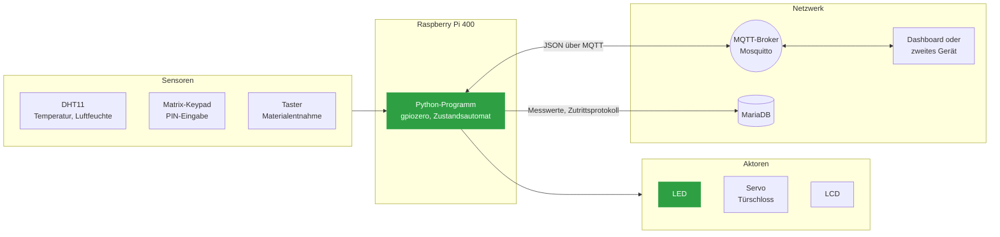
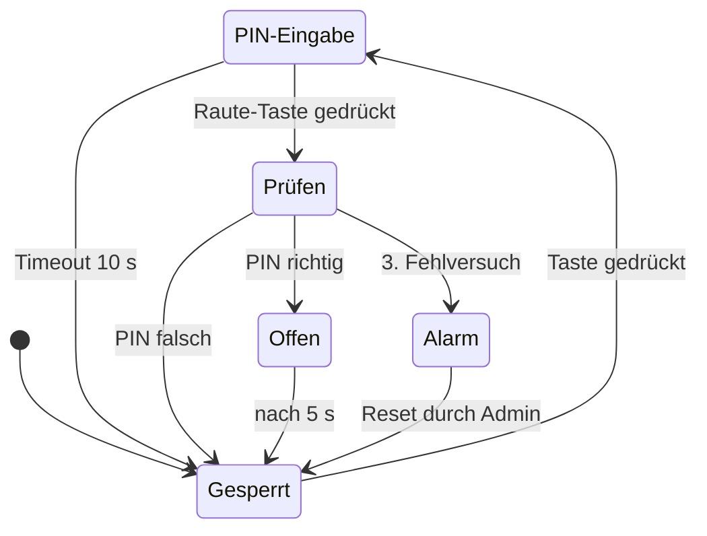
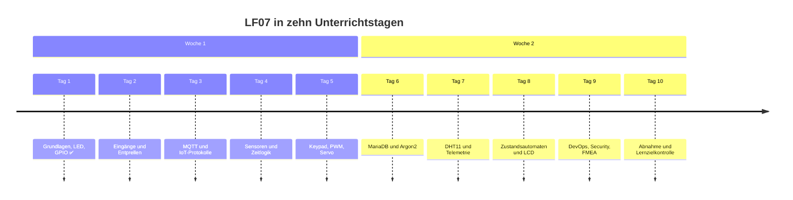
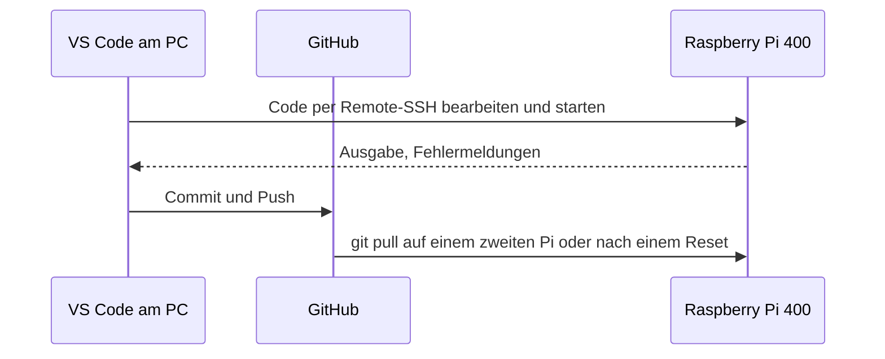

<a id="top"></a>

<p align="center">
  <a href="README.md"></a>
  <a href="README.de.md"></a>
</p>

<p align="center">
  
</p>

<p align="center">
  
  
  
  
  
</p>

<p align="center">
  <b>Sensoren messen. Software entscheidet. Aktoren handeln.</b><br>
  Praxisprojekte aus Lernfeld 7 meiner Umschulung zum Fachinformatiker für Systemintegration.
</p>

<p align="center">
  
</p>

<p align="center">
  <a href="#aktueller-stand">Aktueller Stand</a> ·
  <a href="#architektur">Architektur</a> ·
  <a href="#projekte">Projekte</a> ·
  <a href="#übungen">Übungen</a> ·
  <a href="#zeitplan">Zeitplan</a> ·
  <a href="#schnellstart">Schnellstart</a> ·
  <a href="#sicherheit">Sicherheit</a>
</p>

---

> [!NOTE]
> Dieses Repo wächst mit dem Unterricht. Die zehn SENTINEL-Projekte liegen in `projekte/`, zusätzliche Übungen in `uebungen/`. Jeder Ordner bringt README, Code und Schaltplan mit. Die Fortschrittsanzeige zählt beides.

## Auf einen Blick

<table>
<tr>
<td width="55%" valign="top">

**Was ist ein cyber-physisches System?**

Ein cyber-physisches System (CPS) verbindet Software mit der echten Welt. Ein Temperatursensor meldet 31 °C, das Programm vergleicht den Wert mit einem Grenzwert, und ein Lüfter springt an. Der Raspberry Pi ist das Gehirn, die GPIO-Pins sind seine Hände.

**Was passiert hier?**

Zehn Projekte in zwei Wochen, von einer einzelnen LED bis zu SENTINEL: ein vernetztes System mit PIN-Zutrittskontrolle, Umweltüberwachung, Datenbank und Kundenabnahme.

</td>
<td width="45%" valign="top">


<!-- Bildquelle eintragen oder durch ein eigenes Foto ersetzen, bevor das Repo öffentlich wird -->

</td>
</tr>
</table>

## Aktueller Stand

<table>
<tr>
<td width="45%" valign="top">


</td>
<td width="55%" valign="top">

**Zuletzt fertig, alles am Raspberry Pi 400 aufgebaut und getestet**

- ✅ Übung Tag 4: [Ampel dimmen](uebungen/tag04-ampel-dimmen/). Rot leuchtet mit 100 %, gelb mit 60 %, grün mit 20 %. Gedimmt wird per PWM.
- ✅ Übung Tag 3: [Fußgängerampel](uebungen/tag03-fussgaengerampel/). Auto- und Fußgängerampel mit Anforderungstaster. Ein Summer tickt während Fußgänger-Grün als Signal für blinde Menschen.
- ✅ Projekt 01: [SENTINEL Projektstart](projekte/01-sentinel-projektstart/). Eine Status-LED an GPIO25 blinkt 1 s an, 2 s aus.

**Was ich dabei gelernt habe:** GPIO-Nummer und Pinnummer sind zwei verschiedene Dinge. Jede LED braucht einen Vorwiderstand. Ein Taster braucht einen Pull-up und Entprellen, und den Summer schaltet ein Transistor, weil der Pin ihn nicht allein treiben sollte. Mit PWM lässt sich eine LED dimmen, obwohl der Pin nur an oder aus kennt.

**Als Nächstes:** Projekt 02 Lokale Materialstation. Ein Taster wird zum Eingang, mit Pull-up und Entprellen.

</td>
</tr>
</table>

## Architektur

Das Zielbild für SENTINEL. Jedes Projekt ergänzt einen Baustein. Grün ist schon umgesetzt.



### Beispiel: Zutrittskontrolle als Zustandsautomat

So verhält sich ein PIN-Schloss (Projekt 05 und 06). Wer die Zustände zuerst aufzeichnet, schreibt und testet den Code danach deutlich leichter.



<p align="right"><a href="#top">nach oben ↑</a></p>

## Projekte

| Nr. | Projekt | Was es macht | Schwerpunkt | Status |
|:-:|---|---|---|:-:|
| 01 | [SENTINEL Projektstart](projekte/01-sentinel-projektstart/) | Schaltet eine LED sicher über einen GPIO-Pin | Vorwiderstand, GPIO-Ausgang | ✅ |
| 02 | Lokale Materialstation | Erfasst Entnahmen per Taster | Pull-up, Entprellen, Events | ⬜ |
| 03 | Vernetzte Materialstation | Sendet jede Entnahme als MQTT-Nachricht | MQTT, JSON, Topics | ⬜ |
| 04 | Sicherheitsmodul Klimaprüfraum | Warnt, bevor jemand einen unsicheren Raum betritt | Sensorwahl, Countdown | ⬜ |
| 05 | Lokale Zutrittskontrolle | Öffnet ein Schloss nach der richtigen PIN | Keypad, PWM, Servo | ⬜ |
| 06 | Dynamische Zutrittskontrolle | Prüft PINs gegen eine Datenbank | MariaDB, Argon2 | ⬜ |
| 07 | Umweltüberwachung | Protokolliert Klimadaten und reagiert auf Grenzwerte | DHT11, Hysterese | ⬜ |
| 08 | Gesicherte Transportbox | Verfolgt den Zustand der Box und meldet ihn | Zustandsautomat, LCD | ⬜ |
| 09 | SENTINEL Release Readiness | Testet das Gesamtsystem und bewertet Risiken | Systemtest, FMEA | ⬜ |
| 10 | SENTINEL Kundenabnahme | Übergibt das System an den "Kunden" | Abnahme, Präsentation | ⬜ |

<sub>⬜ offen · 🟡 in Arbeit · ✅ fertig</sub>

## Übungen

Zusätzliche Aufgaben aus dem Unterricht und dem Raspberry-Pi-Handbuch. Sie gehören nicht zu SENTINEL, zählen aber in der Fortschrittsanzeige mit.

| Tag | Übung | Was sie macht | Schwerpunkt | Status |
|:-:|---|---|---|:-:|
| 03 | [Fußgängerampel](uebungen/tag03-fussgaengerampel/) | Auto- und Fußgängerampel mit Anforderungstaster und Ticksignal | Pull-up, Entprellen, Event, PNP-Transistor | ✅ |
| 04 | [Ampel dimmen](uebungen/tag04-ampel-dimmen/) | Lässt die Ampel in drei Stufen leuchten: rot 100 %, gelb 60 %, grün 20 % | PWM, Tastgrad, PWMLED | ✅ |
| 05 | [Zutrittskontrolle](uebungen/tag05-zutrittskontrolle/) | PIN am 4x4-Keypad, Sperre nach 3 Fehlversuchen, Protokoll in SQLite, Live-Dashboard | Matrix-Keypad, SQLite, Hash mit Salt, Flask | 🟡 |

<details>
<summary><b>Geplante MQTT-Topics</b> (Entwurf, ändert sich mit Projekt 03)</summary>

| Topic | Richtung | Beispiel-Payload |
|---|---|---|
| `sentinel/station1/material` | Pi → Broker | `{"item": "M3-Schrauben", "action": "taken", "ts": "2026-11-18T09:15:00Z"}` |
| `sentinel/room1/climate` | Pi → Broker | `{"temp_c": 22.4, "humidity": 48}` |
| `sentinel/door1/state` | Pi → Broker | `{"state": "locked"}` |
| `sentinel/door1/command` | Broker → Pi | `{"cmd": "unlock", "by": "admin"}` |

</details>

## Zeitplan

Geplanter Ablauf der zwei Unterrichtswochen.[^1]



### Was ich nach LF07 kann

- [ ] LEDs, Taster und Sensoren sicher an den GPIO-Header anschließen
- [ ] Eingänge zuverlässig mit Pull-up-Widerständen und Entprellen einlesen
- [ ] Geräte per MQTT mit einer klaren JSON-Schnittstelle verbinden
- [ ] Messwerte und gehashte PINs in MariaDB speichern
- [ ] Abläufe als Zustandsautomat modellieren
- [ ] Risiken mit Bedrohungsanalyse und FMEA bewerten
- [ ] Ein System beim Kunden präsentieren und übergeben

<p align="right"><a href="#top">nach oben ↑</a></p>

## Hardware

| Teil | Details |
|---|---|
| Raspberry Pi 400 | Rechner in der Tastatur, Broadcom BCM2711 mit 4 Kernen (1,8 GHz), 4 GB RAM, WLAN, Bluetooth 5.0, Gigabit-Ethernet |
| Anschlüsse | 40-poliger GPIO-Header an der Rückseite, 2 × Micro-HDMI, USB 3.0 und 2.0, USB-C für Strom |
| Starter Kit | Maus, USB-C-Netzteil, Micro-HDMI-Kabel, microSD-Karte mit Raspberry Pi OS, Beginner's Guide |
| Bauteile | LEDs mit Vorwiderständen, Taster, DHT11, Matrix-Keypad, Servo, LCD, Steckbrett und Jumperkabel |

> [!TIP]
> Im Terminal des Pi `pinout` eingeben. Der Befehl zeigt eine Karte aller 40 GPIO-Pins, das spart viel Abzählen.

## Aufbau des Repos

```text
.
├── projekte/                     SENTINEL-Projekte 01 bis 10
│   └── 01-sentinel-projektstart/
│       ├── README.md, README.de.md
│       ├── main.py
│       └── schaltplan/           Fritzing-Datei (.fzz) und Bilder
├── uebungen/                     Übungen aus Unterricht und Handbuch
│   └── tag03-fussgaengerampel/   gleicher Aufbau wie ein Projekt
├── docs/                         Banner, Bilder und Badges für die README
├── .github/vorlagen/             README-Vorlagen für neue Projekte
└── requirements.txt
```

## Schnellstart

```bash
# Repo auf den Pi holen
git clone https://github.com/philmay1/lf07-cyber-physische-systeme.git
cd lf07-cyber-physische-systeme

# Virtuelle Umgebung anlegen und Pakete installieren
python3 -m venv --system-site-packages .venv
source .venv/bin/activate
pip install -r requirements.txt

# Ein Projekt starten, zum Beispiel das erste
python3 projekte/01-sentinel-projektstart/main.py

# Oder die Fußgängerampel
python3 uebungen/tag03-fussgaengerampel/ampel.py
```

<details>
<summary><b>Mein Arbeitsablauf: PC, GitHub und Pi</b></summary>



Nützliche Tastenkürzel in VS Code: <kbd>Strg</kbd> + <kbd>Shift</kbd> + <kbd>P</kbd> öffnet die Befehlspalette, <kbd>Strg</kbd> + <kbd>Shift</kbd> + <kbd>G</kbd> die Quellcodeverwaltung.

</details>

## Sicherheit

> [!WARNING]
> Die GPIO-Pins arbeiten mit 3,3 V. Wer 5 V auf einen Eingang legt, kann den Pi zerstören. Jede LED braucht einen Vorwiderstand, und beim Umstecken ist der Pi vom Strom getrennt.

> [!IMPORTANT]
> Passwörter, PINs, WLAN-Daten und Tokens kommen nie in den Code. Sie stehen in einer `.env`-Datei, die `.gitignore` vom Repo ausschließt. PINs speichere ich nur als Argon2-Hash.

## Über mich

Ich mache eine Umschulung zum Fachinformatiker für Systemintegration bei der GFN. In diesem Repo dokumentiere ich, was ich in Lernfeld 7 praktisch umgesetzt habe.

<!-- Optional: Link zum GitHub-Profil oder zu LinkedIn ergänzen -->

<p align="right"><a href="#top">nach oben ↑</a></p>

[^1]: Die Reihenfolge folgt der offiziellen Agenda. Die Aufteilung auf die Tage ist meine Schätzung.
