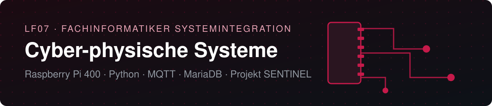

<p align="center">
  <a href="README.md"></a>
  <a href="README.de.md"></a>
</p>

<p align="center">
  
</p>

<p align="center">
  
  
  
  
  
</p>

<p align="center">
  Projekte und Übungen aus Lernfeld 7 meiner Umschulung zum Fachinformatiker für Systemintegration.
</p>

## Worum es geht

Ein cyber-physisches System (CPS) verbindet Software mit der echten Welt. Sensoren messen etwas, zum Beispiel Temperatur oder einen Tastendruck. Ein Programm wertet die Messung aus und entscheidet. Aktoren setzen die Entscheidung um, etwa eine LED, ein Servo oder ein Display.

In diesem Lernfeld baue ich solche Systeme Schritt für Schritt auf dem Raspberry Pi 400. Am Anfang steht eine einzelne LED, am Ende das Gesamtprojekt SENTINEL mit Zutrittskontrolle, Umweltüberwachung und Kundenabnahme.

<p align="center">
  <br>
  <sub>Raspberry Pi 400 Personal Computer Kit, die Hardware für alle Projekte in diesem Repo</sub>
  <!-- Bildquelle eintragen oder durch ein eigenes Foto ersetzen, bevor das Repo öffentlich wird -->
</p>

## Inhalt

- [Hardware](#hardware)
- [Software und Werkzeuge](#software-und-werkzeuge)
- [Aufbau des Repos](#aufbau-des-repos)
- [Projekte](#projekte)
- [Lernfortschritt](#lernfortschritt)
- [Schnellstart auf dem Pi](#schnellstart-auf-dem-pi)
- [Sicherheit](#sicherheit)
- [Über mich](#über-mich)

## Hardware

| Teil | Details |
|---|---|
| Raspberry Pi 400 | Rechner in der Tastatur, Broadcom BCM2711 mit 4 Kernen (1,8 GHz), 4 GB RAM, WLAN, Bluetooth 5.0, Gigabit-Ethernet |
| Anschlüsse | 40-poliger GPIO-Header an der Rückseite, 2 × Micro-HDMI, USB 3.0 und 2.0, USB-C für Strom |
| Starter Kit | Maus, USB-C-Netzteil, Micro-HDMI-Kabel, microSD-Karte mit Raspberry Pi OS, Beginner's Guide |
| Bauteile | LEDs mit Vorwiderständen, Taster, DHT11, Matrix-Keypad, Servo, LCD, Steckbrett und Jumperkabel |

## Software und Werkzeuge

| Bereich | Einsatz |
|---|---|
| Raspberry Pi OS | Betriebssystem auf dem Pi |
| Python 3 mit `gpiozero` | GPIO ansteuern: LEDs, Taster, Servo |
| MQTT (Mosquitto, `paho-mqtt`) | Nachrichten zwischen Geräten im JSON-Format |
| MariaDB | Messwerte und Zugangsdaten speichern |
| Argon2 | PINs und Passwörter sicher hashen |
| Git, GitHub, VS Code mit Remote-SSH | Code am PC schreiben, auf dem Pi ausführen, Versionen sichern |

## Aufbau des Repos

```text
lf07-cyber-physische-systeme/
├── README.md                 englische Fassung
├── README.de.md              diese Seite
├── docs/
│   ├── badges/               Badges als lokale SVG-Dateien
│   ├── img/                  Banner, Fotos, Screenshots
│   └── schaltplaene/         Schaltpläne der Aufbauten
├── projekte/
│   ├── 01-sentinel-projektstart/
│   ├── 02-lokale-materialstation/
│   ├── 03-vernetzte-materialstation/
│   ├── 04-sicherheitsmodul-klimapruefraum/
│   ├── 05-lokale-zutrittskontrolle/
│   ├── 06-dynamische-zutrittskontrolle/
│   ├── 07-umweltueberwachung/
│   ├── 08-gesicherte-transportbox/
│   ├── 09-sentinel-release-readiness/
│   └── 10-sentinel-kundenabnahme/
└── vorlagen/
    ├── PROJECT_README.md     Projektvorlage auf Englisch
    └── PROJEKT_README.de.md  Projektvorlage auf Deutsch
```

Jeder Projektordner bekommt eine eigene README nach der [Vorlage](vorlagen/PROJEKT_README.de.md): Ziel, Schaltung, Pinbelegung, Start, Test und was ich dabei gelernt habe.

## Projekte

| Nr. | Projekt | Thema | Status |
|---|---|---|---|
| 01 | [SENTINEL Projektstart](projekte/01-sentinel-projektstart/) | sichere LED-Schaltung, GPIO-Ausgang | ⬜ offen |
| 02 | [Lokale Materialstation](projekte/02-lokale-materialstation/) | digitale Eingänge, Pull-up und Pull-down, Entprellen | ⬜ offen |
| 03 | [Vernetzte Materialstation](projekte/03-vernetzte-materialstation/) | MQTT, JSON, Topics | ⬜ offen |
| 04 | [Sicherheitsmodul Klimaprüfraum](projekte/04-sicherheitsmodul-klimapruefraum/) | Sensorwahl, Zustände, Countdown | ⬜ offen |
| 05 | [Lokale Zutrittskontrolle](projekte/05-lokale-zutrittskontrolle/) | Matrix-Keypad, PIN, PWM und Servo | ⬜ offen |
| 06 | [Dynamische Zutrittskontrolle](projekte/06-dynamische-zutrittskontrolle/) | MariaDB, Argon2-Hashes | ⬜ offen |
| 07 | [Umweltüberwachung](projekte/07-umweltueberwachung/) | DHT11, Telemetrie, Hysterese | ⬜ offen |
| 08 | [Gesicherte Transportbox](projekte/08-gesicherte-transportbox/) | Zustandsautomat, LCD, MQTT in beide Richtungen | ⬜ offen |
| 09 | [SENTINEL Release Readiness](projekte/09-sentinel-release-readiness/) | Systemtest, Bedrohungsanalyse, FMEA | ⬜ offen |
| 10 | [SENTINEL Kundenabnahme](projekte/10-sentinel-kundenabnahme/) | Abnahme, Übergabe, Präsentation | ⬜ offen |

Status: ⬜ offen, 🟡 in Arbeit, ✅ fertig

## Lernfortschritt

Die Reihenfolge folgt der Agenda des Lernfelds. Die Aufteilung auf die Tage ist meine Schätzung.

<details>
<summary><b>Woche 1</b>: Grundlagen, Eingänge, Vernetzung, Aktorik</summary>

| Tag | Themen | Erledigt |
|---|---|---|
| 1 | Orientierung, CPS-Architektur und Plattformwahl, Elektrosicherheit, sichere LED-Schaltung, Inbetriebnahme von Pi und GPIO | ⬜ |
| 2 | Digitale Eingänge, definierte Ruhepegel, Polling, Eventhandling, Entprellen | ⬜ |
| 3 | MQTT und M2M, IoT-Protokolle, Industrial Internet, JSON und Schnittstellenvertrag | ⬜ |
| 4 | Sensorwahl und Personensicherheit, Zeitlogik, Zustände, Countdown | ⬜ |
| 5 | Matrix-Keypad und PIN-Eingabe, PWM, Servo, sichere Aktorik | ⬜ |

</details>

<details>
<summary><b>Woche 2</b>: Daten, Sicherheit, Abnahme</summary>

| Tag | Themen | Erledigt |
|---|---|---|
| 6 | MariaDB, SQL und Datenmodell, Hashing mit Argon2, sichere Konfiguration | ⬜ |
| 7 | DHT11-Messung und Plausibilität, Telemetrie, Persistenz, Hysterese | ⬜ |
| 8 | Zustandsautomaten, Transportlogik, paralleles LCD, MQTT in beide Richtungen | ⬜ |
| 9 | DevOps, Git und Systemtest, Bedrohungsanalyse, FMEA und Risikopriorisierung | ⬜ |
| 10 | Abnahme, Übergabe und Kundenpräsentation, Lernzielkontrolle, Lessons Learned | ⬜ |

</details>

## Schnellstart auf dem Pi

```bash
# Repo auf den Pi holen
git clone https://github.com/<benutzername>/lf07-cyber-physische-systeme.git
cd lf07-cyber-physische-systeme

# Virtuelle Umgebung anlegen und Pakete installieren
python3 -m venv .venv
source .venv/bin/activate
pip install -r requirements.txt

# Ein Projekt starten, zum Beispiel das erste
python3 projekte/01-sentinel-projektstart/main.py
```

Ich schreibe den Code in VS Code am PC und bin per Remote-SSH mit dem Pi verbunden. Jeder funktionierende Stand bekommt einen Commit.

## Sicherheit

- Vor jeder Änderung an der Schaltung trenne ich den Pi vom Strom.
- Die GPIO-Pins vertragen nur 3,3 V. Eine LED bekommt immer einen Vorwiderstand.
- Passwörter, PINs, WLAN-Daten und Tokens stehen in einer `.env`-Datei. Die `.gitignore` schließt sie vom Upload aus.
- PINs speichere ich nur als Argon2-Hash, nie im Klartext.

## Über mich

Ich mache eine Umschulung zum Fachinformatiker für Systemintegration bei der GFN. In diesem Repo dokumentiere ich, was ich in Lernfeld 7 praktisch umgesetzt habe.

<!-- Optional: Link zum GitHub-Profil oder zu LinkedIn ergänzen -->
