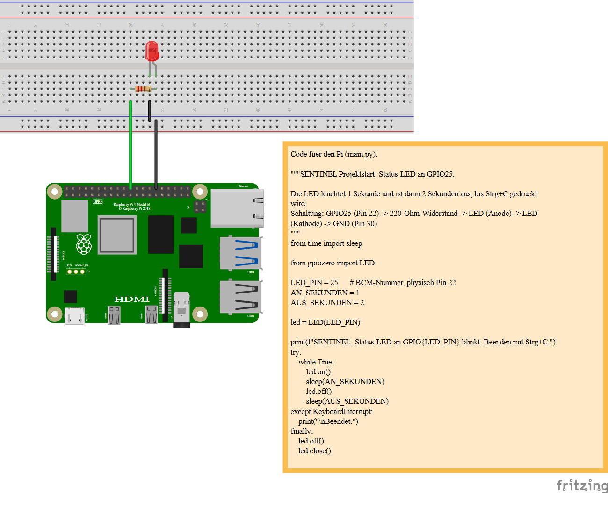
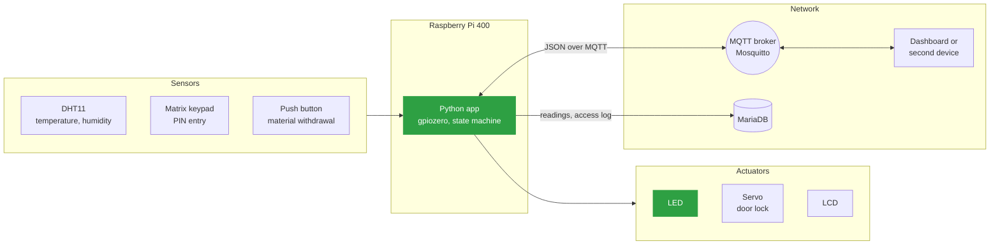
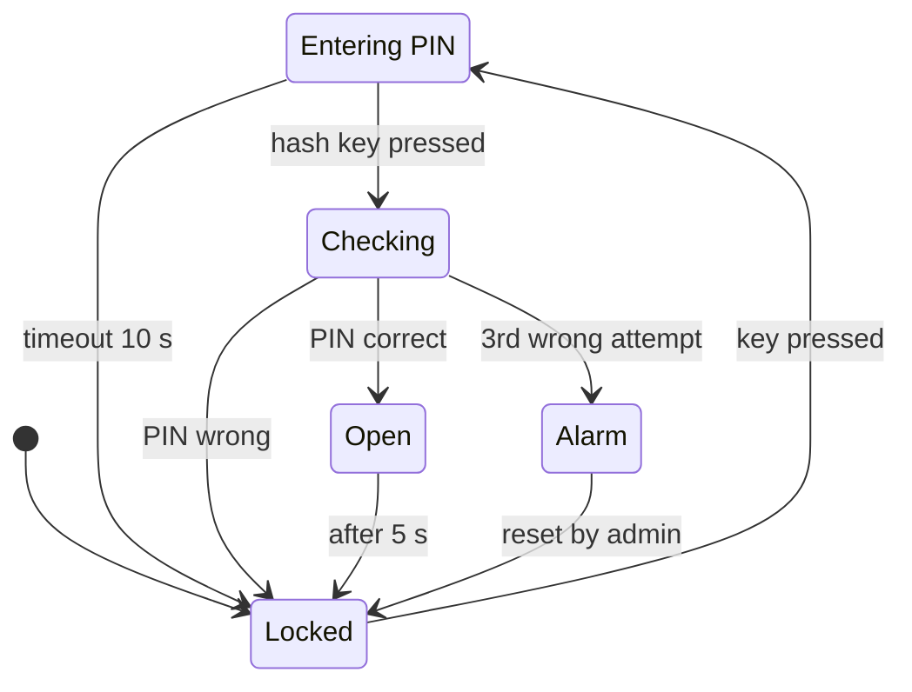
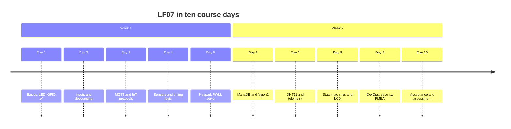
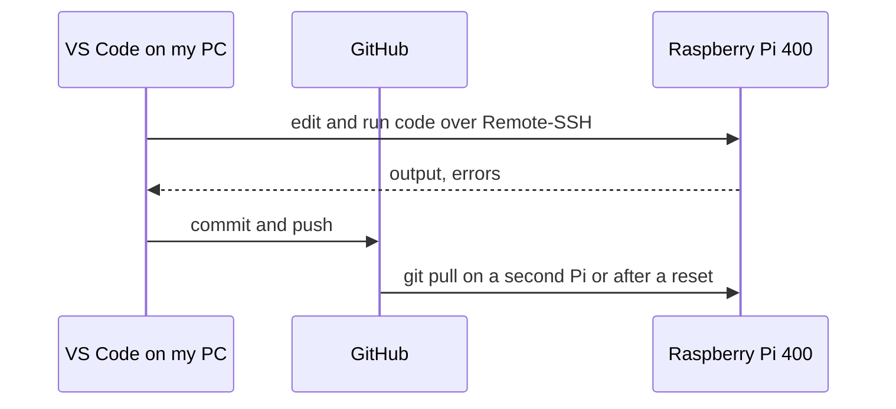

<a id="top"></a>

<p align="center">
  <a href="README.md"></a>
  <a href="README.de.md"></a>
</p>

<p align="center">
  
</p>

<p align="center">
  
  
  
  
  
</p>

<p align="center">
  <b>Sensors measure. Software decides. Actuators act.</b><br>
  Hands-on projects from learning field 7 of my retraining as an IT specialist for system integration.
</p>

<p align="center">
  
</p>

<p align="center">
  <a href="#current-status">Current status</a> ·
  <a href="#architecture">Architecture</a> ·
  <a href="#projects">Projects</a> ·
  <a href="#roadmap">Roadmap</a> ·
  <a href="#quick-start">Quick start</a> ·
  <a href="#safety-and-security">Safety</a>
</p>

---

> [!NOTE]
> This repo grows with the course. Every project gets its own folder, its own README and a status in the [project table](#projects).

## At a glance

<table>
<tr>
<td width="55%" valign="top">

**What is a cyber-physical system?**

A cyber-physical system (CPS) connects software to the physical world. A temperature sensor reports 31 °C, the program compares that with a limit, and a fan switches on. The Raspberry Pi is the brain, the GPIO pins are its hands.

**What happens here?**

Ten projects in two weeks, from a single LED to SENTINEL: a networked system with PIN access control, environmental monitoring, a database and a customer acceptance test.

</td>
<td width="45%" valign="top">


<!-- Add the image source or replace it with your own photo before making the repo public -->

</td>
</tr>
</table>

## Current status

<table>
<tr>
<td width="45%" valign="top">



</td>
<td width="55%" valign="top">

**✅ Project 01 done: [SENTINEL kickoff](projekte/01-sentinel-projektstart/)**

A red LED is wired through a 220 ohm series resistor to GPIO25 (pin 22). A short Python program using `gpiozero` makes it blink: 1 s on, 2 s off. After Ctrl+C the LED turns off and the pin is released. Tested on the Raspberry Pi 400.

What I learned: the GPIO number and the pin number are two different things, and without a series resistor the pin can get damaged.

**Next up:** [Project 02 Local material station](projekte/02-lokale-materialstation/). A push button becomes an input, with pull-up and debouncing.

</td>
</tr>
</table>

## Architecture

The target picture for SENTINEL. Every project adds one building block. Green is already built.



### Example: access control as a state machine

This is how a PIN lock (project 05 and 06) behaves. Drawing the states first makes the code much easier to write and to test.



<p align="right"><a href="#top">back to top ↑</a></p>

## Projects

| No. | Project | What it does | Key skills | Status |
|:-:|---|---|---|:-:|
| 01 | [SENTINEL kickoff](projekte/01-sentinel-projektstart/) | Lights an LED safely through a GPIO pin | Series resistor, GPIO output | ✅ |
| 02 | [Local material station](projekte/02-lokale-materialstation/) | Registers withdrawals with a button | Pull-up, debouncing, events | ⬜ |
| 03 | [Networked material station](projekte/03-vernetzte-materialstation/) | Sends every withdrawal as an MQTT message | MQTT, JSON, topics | ⬜ |
| 04 | [Safety module for a climate test room](projekte/04-sicherheitsmodul-klimapruefraum/) | Warns before anyone enters an unsafe room | Sensor choice, countdown | ⬜ |
| 05 | [Local access control](projekte/05-lokale-zutrittskontrolle/) | Opens a lock after the right PIN | Keypad, PWM, servo | ⬜ |
| 06 | [Dynamic access control](projekte/06-dynamische-zutrittskontrolle/) | Checks PINs against a database | MariaDB, Argon2 | ⬜ |
| 07 | [Environmental monitoring](projekte/07-umweltueberwachung/) | Logs climate data and reacts to limits | DHT11, hysteresis | ⬜ |
| 08 | [Secured transport box](projekte/08-gesicherte-transportbox/) | Tracks the box state and reports it | State machine, LCD | ⬜ |
| 09 | [SENTINEL release readiness](projekte/09-sentinel-release-readiness/) | Tests the whole system and rates its risks | System test, FMEA | ⬜ |
| 10 | [SENTINEL customer acceptance](projekte/10-sentinel-kundenabnahme/) | Hands the system over to the "customer" | Acceptance, presentation | ⬜ |

<sub>⬜ open · 🟡 in progress · ✅ done</sub>

<details>
<summary><b>Planned MQTT topics</b> (draft, will change with project 03)</summary>

| Topic | Direction | Example payload |
|---|---|---|
| `sentinel/station1/material` | Pi → broker | `{"item": "M3 screws", "action": "taken", "ts": "2026-11-18T09:15:00Z"}` |
| `sentinel/room1/climate` | Pi → broker | `{"temp_c": 22.4, "humidity": 48}` |
| `sentinel/door1/state` | Pi → broker | `{"state": "locked"}` |
| `sentinel/door1/command` | broker → Pi | `{"cmd": "unlock", "by": "admin"}` |

</details>

## Roadmap

Planned schedule for the two course weeks.[^1]



### What I will be able to do after LF07

- [ ] Wire LEDs, buttons and sensors safely to the GPIO header
- [ ] Read inputs reliably with pull-up resistors and debouncing
- [ ] Connect devices over MQTT with a clear JSON interface
- [ ] Store sensor data and hashed PINs in MariaDB
- [ ] Model behaviour as a state machine
- [ ] Assess risks with a threat analysis and an FMEA
- [ ] Present and hand over a system to a customer

<p align="right"><a href="#top">back to top ↑</a></p>

## Hardware

| Part | Details |
|---|---|
| Raspberry Pi 400 | Computer built into a keyboard, Broadcom BCM2711 quad core (1.8 GHz), 4 GB RAM, Wi-Fi, Bluetooth 5.0, Gigabit Ethernet |
| Ports | 40-pin GPIO header on the back, 2 × micro HDMI, USB 3.0 and 2.0, USB-C power |
| Starter kit | Mouse, USB-C power supply, micro HDMI cable, microSD card with Raspberry Pi OS, Beginner's Guide |
| Components | LEDs with series resistors, push buttons, DHT11, matrix keypad, servo, LCD, breadboard and jumper wires |

> [!TIP]
> Run `pinout` in the Pi's terminal. It prints a map of all 40 GPIO pins, which saves a lot of counting.

## Quick start

```bash
# Get the repo onto the Pi
git clone https://github.com/philmay1/lf07-cyber-physische-systeme.git
cd lf07-cyber-physische-systeme

# Create a virtual environment and install packages
python3 -m venv --system-site-packages .venv
source .venv/bin/activate
pip install -r requirements.txt

# Run a project, for example the first one
python3 projekte/01-sentinel-projektstart/main.py
```

<details>
<summary><b>My workflow: PC, GitHub and Pi</b></summary>



Useful shortcuts in VS Code: <kbd>Ctrl</kbd> + <kbd>Shift</kbd> + <kbd>P</kbd> opens the command palette, <kbd>Ctrl</kbd> + <kbd>Shift</kbd> + <kbd>G</kbd> opens source control.

</details>

## Safety and security

> [!WARNING]
> GPIO pins work with 3.3 V. Connecting 5 V to an input pin can destroy the Pi. Every LED needs a series resistor, and the Pi stays unplugged while I change the wiring.

> [!IMPORTANT]
> Passwords, PINs, Wi-Fi credentials and tokens never go into the code. They live in a `.env` file that `.gitignore` keeps out of the repo, and PINs are stored only as Argon2 hashes.

## About me

I am retraining as an IT specialist for system integration at GFN in Germany. This repo documents what I built hands-on in learning field 7.

<!-- Optional: add a link to your GitHub profile or LinkedIn -->

<p align="right"><a href="#top">back to top ↑</a></p>

[^1]: The order follows the official course agenda. The split across days is my own estimate.
