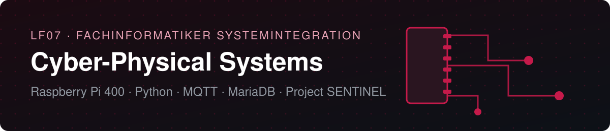
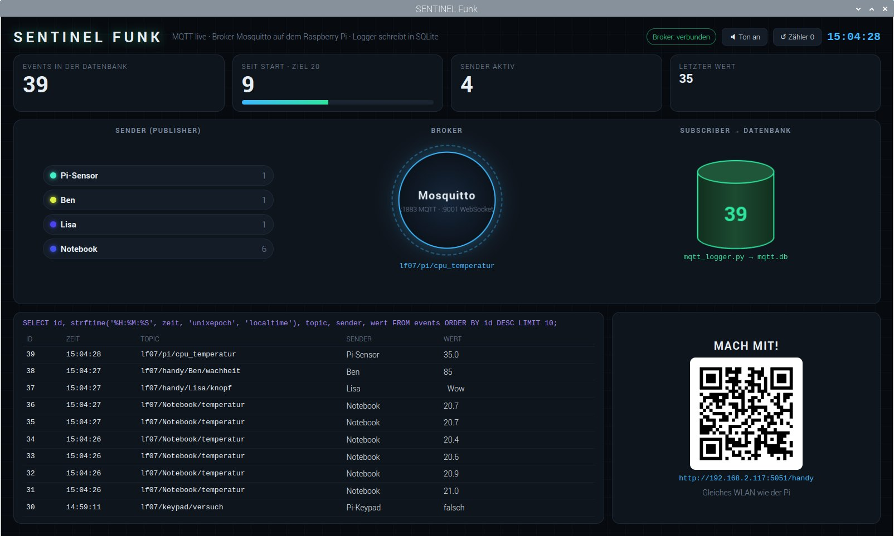
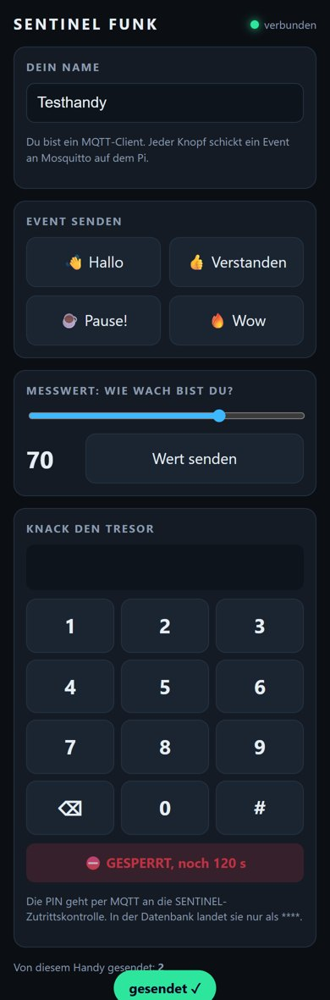
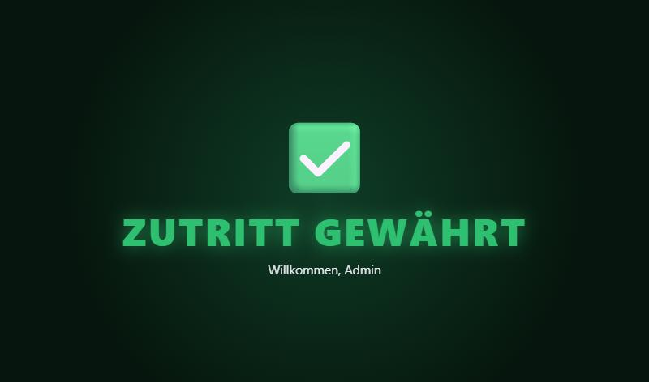
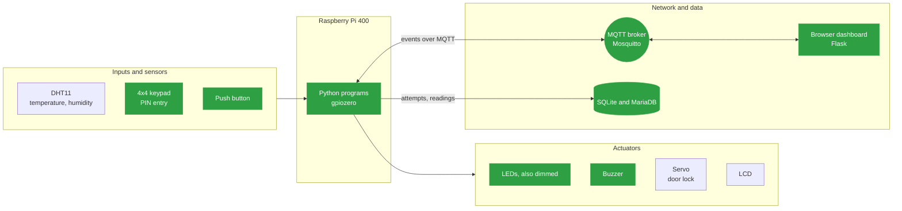
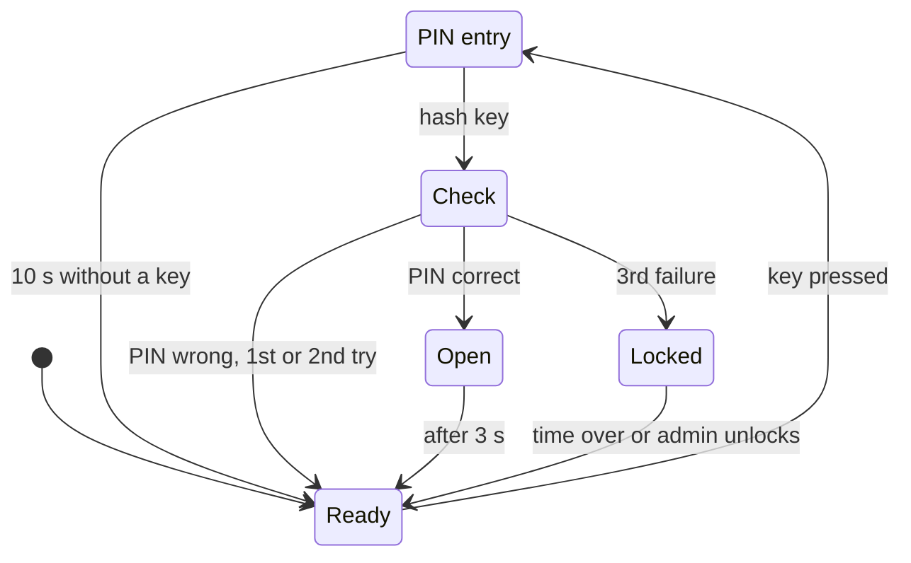
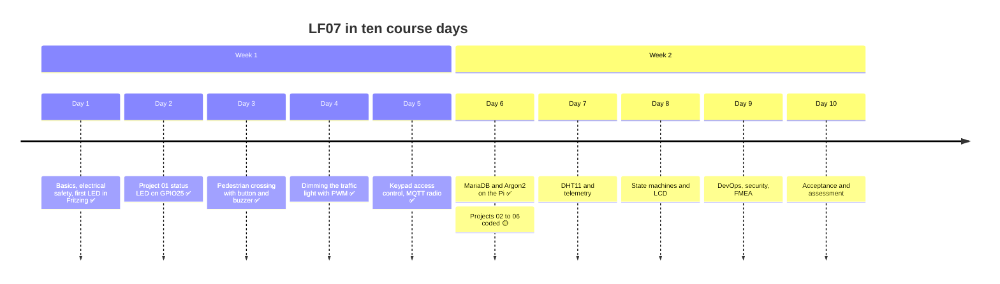
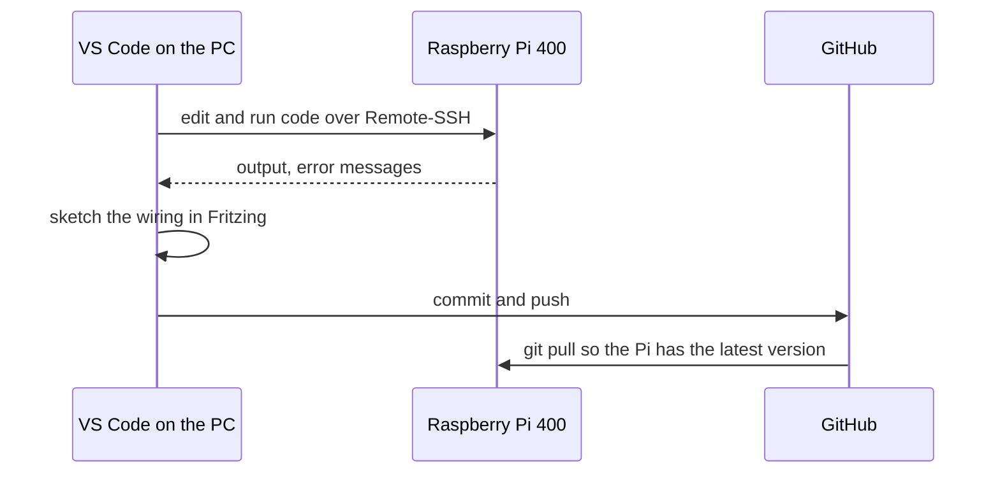

<a id="top"></a>

<p align="center">
  <a href="README.md"></a>
  <a href="README.de.md"></a>
</p>

<p align="center">
  
</p>

<p align="center">
  
  
  
  
  
  
</p>

<p align="center">
  <b>Sensors measure. Software decides. Actuators act.</b><br>
  Hands-on projects from learning field 7 of my retraining as an IT specialist for system integration.
</p>

<p align="center">
  
</p>

<p align="center">
  <a href="#highlights">Highlights</a> ·
  <a href="#projects">Projects</a> ·
  <a href="#exercises">Exercises</a> ·
  <a href="#architecture">Architecture</a> ·
  <a href="#learning-log">Learning log</a> ·
  <a href="#quick-start">Quick start</a> ·
  <a href="#how-i-work">How I work</a> ·
  <a href="#safety-and-security">Safety</a>
</p>

---

> [!NOTE]
> This is a learning repo. I am retraining for IT and not a professional developer. Every line of code has a German comment so I can explain it myself and others can follow it. The repo grows with every course day.

## At a glance

<table>
<tr>
<td width="50%" valign="top">

**What is a cyber-physical system?**

A cyber-physical system (CPS) connects software to the physical world. A sensor measures something, a program decides, and an actuator acts. Example: someone types a wrong PIN on the keypad, the program counts it, and after the third mistake a red light turns on. The Raspberry Pi is the brain, the GPIO pins are its hands.

**What happens here?**

Learning field 7 builds SENTINEL step by step, a small security system with PIN access control, environmental monitoring, a database and a customer acceptance test. Exercises from class come on top. Everything runs and is tested on my own Raspberry Pi 400.

</td>
<td width="50%" valign="top">



<sub>Live board from the MQTT exercise on day 5: phones and the Pi send events to Mosquitto, a logger writes them to SQLite.</sub>

</td>
</tr>
</table>

## Highlights

| | What | Why it is interesting |
|---|---|---|
|  | [MQTT radio](uebungen/tag05-mqtt/) | The whole class becomes an MQTT client via QR code. Every event is stored with a timestamp in SQLite and flies across a live board on the projector. |
|  | [Access control](uebungen/tag05-zutrittskontrolle/) | PIN on a 4x4 keypad, lockout after three failed attempts that survives a reboot. PINs are stored only as salted hashes. |
|  | [Dimming the traffic light](uebungen/tag04-ampel-dimmen/) | An LED can only be on or off. With PWM it still glows at 60 % or 20 %. |

## Projects

The ten SENTINEL projects from the course agenda.

| No. | Project | What it does | Key skills | Status |
|:-:|---|---|---|:-:|
| 01 | [SENTINEL kickoff](projekte/01-sentinel-projektstart/) | Lights a status LED safely through a GPIO pin | Series resistor, GPIO output | ✅ |
| 02 | [Local material station](projekte/02-lokale-materialstation/) | Registers withdrawals with a button, polling and event variant | Pull-up, debouncing, events | 🟡 |
| 03 | [Networked material station](projekte/03-vernetzte-materialstation/) | Sends every withdrawal as a contract-checked MQTT message | MQTT, JSON, last will | 🟡 |
| 04 | [Safety module for a climate test room](projekte/04-sicherheitsmodul-klimapruefraum/) | Raises exactly one alarm if nobody moves for 15 s | State logic, countdown | 🟡 |
| 05 | [Local access control](projekte/05-lokale-zutrittskontrolle/) | Opens an SG90 servo lock after the right PIN | Keypad, PWM, servo | 🟡 |
| 06 | [Dynamic access control](projekte/06-dynamische-zutrittskontrolle/) | Checks PINs against MariaDB, fail closed | MariaDB, Argon2, least privilege | 🟡 |
| 07 | Environmental monitoring | Logs climate data and reacts to limits | DHT11, hysteresis | ⬜ |
| 08 | Secured transport box | Tracks the box state and reports it | State machine, LCD | ⬜ |
| 09 | SENTINEL release readiness | Tests the whole system and rates its risks | System test, FMEA | ⬜ |
| 10 | SENTINEL customer acceptance | Hands the system over to the "customer" | Acceptance, presentation | ⬜ |

<sub>⬜ open · 🟡 code done and tested automatically, hardware test pending · ✅ done and tested on the Pi</sub>

From project 02 on, all projects share one setup and a [central pinout](projekte/README.md#central-pinout) for keypad, servo and traffic light. Shared building blocks such as the MQTT contract, the keypad and the servo door live in [`projekte/gemeinsam/`](projekte/gemeinsam/). Run all automatic tests with `bash projekte/alle_tests.sh`.

## Exercises

Tasks from class and the Raspberry Pi Beginner's Guide. They build the technology SENTINEL needs later and count towards the progress bar.

| Day | Exercise | What it does | Key skills | Status |
|:-:|---|---|---|:-:|
| 03 | [Pedestrian crossing](uebungen/tag03-fussgaengerampel/) | Car and pedestrian lights with a request button and a ticking signal for blind people | Pull-up, debouncing, events, PNP transistor | ✅ |
| 04 | [Dimming the traffic light](uebungen/tag04-ampel-dimmen/) | Lights the traffic light at three levels: red 100 %, yellow 60 %, green 20 % | PWM, duty cycle, PWMLED | ✅ |
| 05 | [Access control](uebungen/tag05-zutrittskontrolle/) | PIN on a 4x4 keypad, lockout after 3 failures, log in SQLite, live dashboard | Matrix keypad, SQLite, salted hash, Flask | 🟡 |
| 05 | [MQTT radio](uebungen/tag05-mqtt/) | Keypad, phones and notebook send events to Mosquitto, a subscriber stores value and time in SQLite | MQTT, publish/subscribe, WebSocket, SQLite | ✅ |
| 08 | [Hardening the MQTT radio](uebungen/tag05-mqtt/#hardening-with-env-envpassword-and-gitignore-day-8) | Login and per-role rights for Mosquitto, settings in `.env`, passwords in `.env.password`, `.gitignore` and a commit guard keep them off GitHub, attack test | .env, ACL, .gitignore, git hook | ✅ |

Access control is 🟡 because its test table on the Pi is not fully ticked yet. It is the basis for projects 05 and 06.

## Architecture

The target picture for SENTINEL. Green parts are already built in projects or exercises.



<details>
<summary><b>Example: access control as a state machine</b></summary>

This is how the PIN lock from the day 5 exercise behaves. Drawing the states first makes the code much easier to write and test.



</details>

<p align="right"><a href="#top">back to top ↑</a></p>

## Learning log

What was built on which day. From day 7 on it is the plan from the agenda.



### What I can do so far

- [x] Wire LEDs, buttons, a buzzer and a 4x4 keypad safely to the GPIO header
- [x] Read inputs reliably with pull-up or pull-down and debouncing
- [x] Dim an LED with PWM
- [x] Connect devices over MQTT (publisher, broker, subscriber)
- [x] Store data and hashed PINs in an SQLite database
- [x] Store PINs with Argon2 in MariaDB, with least privilege and fail closed
- [ ] Read sensors such as the DHT11 and react to limits
- [ ] Assess risks with a threat analysis and an FMEA
- [ ] Present and hand over a system to a customer

<p align="right"><a href="#top">back to top ↑</a></p>

## Hardware

| Part | Details |
|---|---|
| Raspberry Pi 400 | Computer inside a keyboard, Broadcom BCM2711 with 4 cores (1.8 GHz), 4 GB RAM, Wi-Fi, Gigabit Ethernet, 40-pin GPIO header at the back |
| Kit | Miuzei Ultimate Starter Kit: breadboard, jumper wires, LEDs, resistors (220 Ω, 1 kΩ, 10 kΩ), push button, active buzzer, PNP transistor S8550, 4x4 keypad |
| Tools | VS Code with Remote-SSH, Fritzing for breadboard sketches, Git and GitHub |

> [!TIP]
> Type `pinout` in the Pi's terminal. It prints a map of all 40 GPIO pins and saves a lot of counting.

## Repository layout

Every project and every exercise uses the same layout, so everything is found in the same place.

```text
.
├── projekte/                       SENTINEL projects 01 to 10
│   ├── 01-sentinel-projektstart/
│   │   ├── README.md, README.de.md description, pinout, tests
│   │   ├── main.py                 commented code
│   │   └── schaltplan/             Fritzing file (.fzz) and images
│   ├── 02- to 06-.../              code, tests, README per project
│   ├── gemeinsam/                  pinout, MQTT contract, keypad, servo door
│   └── alle_tests.sh               all automatic tests
├── uebungen/                       exercises from class and the guide
│   ├── tag03-fussgaengerampel/
│   ├── tag04-ampel-dimmen/
│   ├── tag05-zutrittskontrolle/    with dashboard and tests
│   └── tag05-mqtt/                 with live board and tests
├── docs/                           banner, badges
├── .github/vorlagen/               README templates for new projects
├── requirements.txt                Python packages
└── LICENSE                         MIT license
```

## Quick start

```bash
# Get the repo onto the Pi
git clone https://github.com/philmay1/lf07-cyber-physische-systeme.git
cd lf07-cyber-physische-systeme

# Install packages (gpiozero comes with Raspberry Pi OS)
python3 -m venv --system-site-packages .venv
source .venv/bin/activate
pip install -r requirements.txt

# Run an example, for instance the pedestrian crossing
python3 uebungen/tag03-fussgaengerampel/ampel.py
```

How to start and test each exercise is described in its own README.

## How I work



- **Plan first, then build:** every circuit gets a Fritzing sketch and a pinout before anything is wired.
- **Comments:** every line of code has a German comment.
- **Tests:** every README has a test table. The larger exercises also have automatic tests with simulated pins (`test_zutritt.py`, `test_funk.py`) that run without hardware.
- **Commits:** short messages like `feat(uebungen): ...` for new features and `docs(...)` for text.

## Safety and security

> [!WARNING]
> GPIO pins work with 3.3 V. Putting 5 V on an input can destroy the Pi. Every LED needs a series resistor, and the Pi is unplugged while rewiring.

> [!IMPORTANT]
> Passwords and PINs never go into the code. The databases (`*.db`) are excluded by `.gitignore`. PINs are stored only as salted hashes (PBKDF2-SHA256), project 06 adds Argon2. Broker and dashboards run without login, so they belong on the home or school network only, never on the internet.

## About me

I am retraining as an IT specialist for system integration. This repo documents what I built hands-on in learning field 7, from the first LED to a networked access control.

## License

The code is released under the [MIT license](LICENSE). You may use and change it as long as the license notice stays.

<p align="right"><a href="#top">back to top ↑</a></p>
