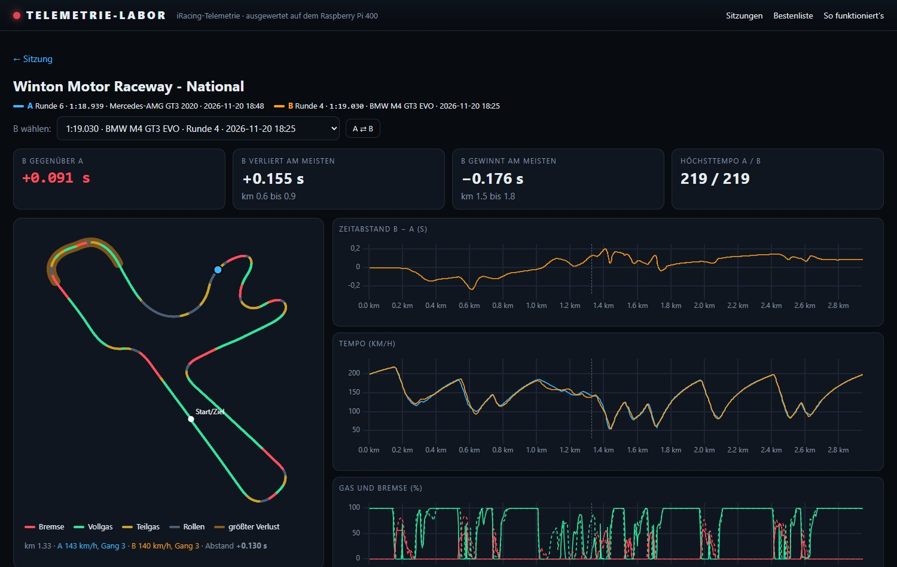
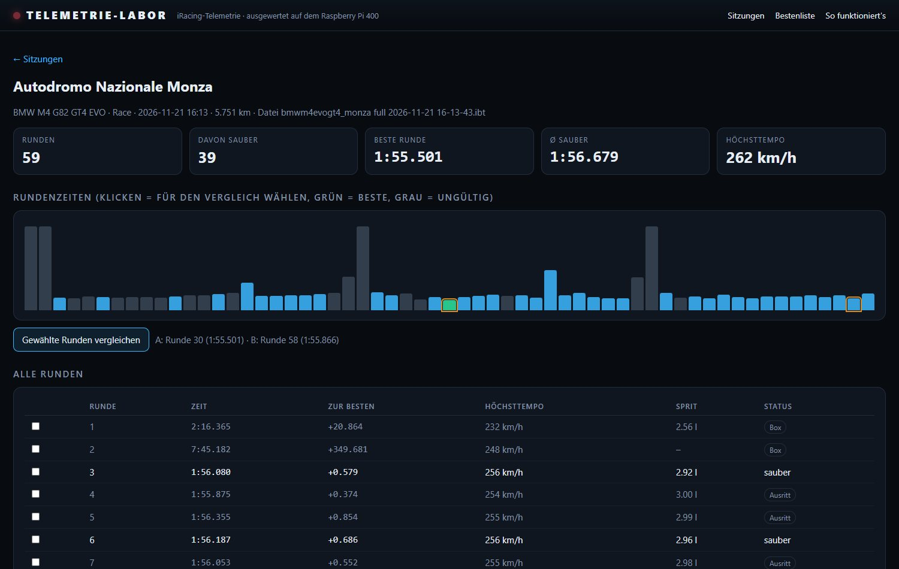
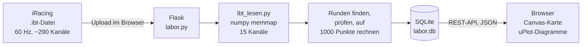

<p align="right"><a href="README.md">English</a> · <a href="README.de.md">Deutsch</a></p>

# Eigenprojekt: Telemetrie-Labor



Ein Web-Dienst auf dem Raspberry Pi 400, der Telemetrie aus dem Rennsimulator iRacing auswertet. Man lädt im Browser eine `.ibt`-Datei hoch. Der Pi zerlegt sie in Runden, prüft jede Runde und speichert die Messkurven in SQLite. Danach lassen sich zwei Runden übereinanderlegen: Streckenkarte, Tempo, Gas, Bremse, Gang und Lenkwinkel, dazu der Zeitabstand an jeder Stelle der Strecke.

Die Aufgabe war: den Pi für etwas Eigenes nutzen. Das Labor ist reine Software und braucht keine Bauteile. Vorgeführt wird es im Browser, auch ohne Simulator im Raum.

## Warum das zu LF07 passt

Ein Rennauto im Simulator ist ein cyber-physisches System. iRacing misst 60 Mal pro Sekunde rund 290 Werte: Tempo, Pedalstellungen, Lenkwinkel, GPS-Position, Sprit, Reifentemperaturen. Das Labor ist der Teil, der aus diesen Sensordaten Erkenntnisse macht, so wie eine Leitstelle bei einer echten Anlage.

## Was es kann

| Seite | Inhalt |
|---|---|
| Sitzungen | Upload per Drag & Drop mit Fortschrittsbalken, Liste aller Sitzungen mit bester Runde |
| Sitzung | Rundenzeiten als Säulen, alle Runden mit Abstand zur Besten, Höchsttempo, Spritverbrauch und Status |
| Vergleich | Streckenkarte aus GPS, eingefärbt nach Bremse, Vollgas, Teilgas und Rollen. Fünf Diagramme mit gemeinsamem Cursor, Abschnittsanalyse in 10 Teilen, größter Verlust auf der Karte markiert. Runde B darf von einer anderen Sitzung oder einem anderen Auto stammen |
| Bestenliste | schnellste saubere Runde pro Strecke und Auto, direkt vergleichbar |
| So funktioniert's | Erklärseite für die Präsentation mit Datenweg, Dateiformat und Live-Zahlen aus der Datenbank |

Eine Runde gilt als ungültig, wenn das Auto in der Boxengasse war, mehr als eine halbe Sekunde neben der Strecke stand (`Ausritt`), nicht auf der Strecke war oder die Aufzeichnung eine Lücke hat.



## Wie es gebaut ist



### Das Dateiformat .ibt

| Bereich | Größe | Inhalt |
|---|---|---|
| Kopf | 112 Byte | Version, Abtastrate, wo Variablenliste, Session-Infos und Daten liegen, Größe eines Datensatzes |
| Datei-Kopf | 32 Byte | Startzeit, Anzahl Runden und Datensätze |
| Variablenliste | 144 Byte pro Kanal | Typ (float, double, int, bool), Position im Datensatz, Name, Einheit |
| Session-Infos | YAML-Text | Strecke, Streckenlänge, Art der Session, alle Fahrer mit Auto |
| Messwerte | ein Datensatz pro 1/60 s | bei Monza GT4 rund 1100 Byte pro Satz |

[`ibt_lesen.py`](ibt_lesen.py) liest den Kopf mit `struct`, baut aus der Variablenliste einen numpy-Datentyp und legt ihn per `np.memmap` über die Datei. numpy liest dann nur die 15 benötigten Spalten. Eine 476-MB-Datei mit 59 Rennrunden ist so auf dem Pi in wenigen Sekunden ausgewertet, ohne dass sie ganz im Arbeitsspeicher liegt.

### Runden finden

Eine Runde endet, wenn `LapDistPct` (Anteil der Runde, 0 bis 1) von über 0,9 auf unter 0,1 springt und `Lap` um eins steigt. Der genaue Zeitpunkt liegt zwischen zwei Messungen und wird linear interpoliert. Gegenprobe mit dem Wert, den iRacing selbst als Rundenzeit meldet: Die Abweichung beträgt höchstens 1 ms.

Danach wird jede Runde auf ein festes Raster von 1000 Punkten entlang der Strecke umgerechnet (`np.interp`). Erst dadurch lassen sich zwei Runden Punkt für Punkt vergleichen, auch wenn die eine schneller war und deshalb weniger Messungen hat. Der Zeitabstand an jeder Stelle ist dann einfach `t_B − t_A`.

### Speichern

[`labor_db.py`](labor_db.py) hat zwei Tabellen: `sitzung` (Strecke, Auto, Datum, Art) und `runde` (Zeit, gültig, Grund, Höchsttempo, Sprit und die Messkurven). Die Kurven werden auf sinnvolle Nachkommastellen gerundet, als JSON geschrieben und mit zlib komprimiert. 110 Runden aus 9 Sitzungen belegen rund 1,8 MB. Die `.ibt` selbst wird nach dem Auswerten gelöscht.

### Oberfläche

Eine einzige Seite ([`static/`](static/)) holt alle Daten als JSON von der REST-API. Die Streckenkarte zeichnet ein Canvas aus Breiten- und Längengrad. Damit sie nicht gestaucht wirkt, werden die Längengrade mit cos(Breite) verkürzt. Die Diagramme kommen von [uPlot](https://github.com/leeoniya/uPlot) (50 KB). Die Bibliothek liegt lokal im Repo, das Labor braucht also kein Internet.

Das Design heißt "Boxenmauer": dunkel wie die Monitore der Renningenieure, Signalrot als Akzent. Zahlen stehen in JetBrains Mono, einer Schrift mit gleich breiten Ziffern, damit Rundenzeiten sauber untereinander stehen. Die schnellste Runde ist lila, so wie im TV-Timing. Unter jedem Diagramm erklärt ein Satz "So lesen:", was man sieht. Alle Farben stehen als Variablen in [`style.css`](static/style.css). Karte und Diagramme lesen dieselben Variablen, deshalb ändert man eine Farbe an genau einer Stelle. Die Schriften (Barlow, Barlow Condensed, JetBrains Mono, SIL Open Font License) liegen in [`static/schrift/`](static/schrift/).

Die Statusleiste unter der Kopfzeile zeigt alle 10 Sekunden, wie es dem Pi geht: CPU-Temperatur, Last, Arbeitsspeicher, Laufzeit, Größe der Datenbank und freier Platz auf der SD-Karte. Die Werte liest [`labor.py`](labor.py) (Funktion `systemwerte`) aus den Textdateien, die Linux unter `/sys` und `/proc` bereitstellt.

## Datenschutz und Sicherheit

- Die Session-Infos jeder `.ibt` enthalten Namen und Kunden-IDs aller Fahrer der Session, bei einem Rennen über 40 fremde Personen. Das Labor liest daraus nur Strecke, Länge, Art der Session und das eigene Auto (über `DriverCarIdx`). Der Test prüft, dass keine fremden Namen oder IDs in der Datenbank landen.
- `.ibt`-Dateien stehen in der `.gitignore` und kommen nie ins öffentliche Repo.
- Ansehen darf jeder im Netz, Hochladen und Löschen nur nach Login. Ohne gesetztes Passwort sind Hochladen und Löschen nur am Pi selbst möglich (localhost).
- Das Passwort setzt man mit `python3 labor.py passwort`. In `.env.password` (Rechte 600) steht danach nur ein PBKDF2-Hash mit 200.000 Runden und der Schlüssel für das Login-Cookie. Die Datei ist wie bei SENTINEL Funk (Tag 8) per `.gitignore` gesperrt und wird vom Commit-Wächter überwacht.
- Bei einem falschen Passwort wartet der Server eine Sekunde, das bremst Durchprobieren.

## Einrichten auf dem Pi

```bash
cd ~/lf07-cyber-physische-systeme/eigenprojekt/telemetrie-labor
bash einrichten.sh                 # Pakete, .env, systemd-Dienst (startet auch nach Neustart)
python3 labor.py passwort          # eigenes Passwort für Upload und Löschen
sudo systemctl restart telemetrie-labor
```

Danach im Browser `http://<IP-des-Pi>:5080` öffnen, im WLAN oder über Tailscale. `bash einrichten.sh status` zeigt den Dienst und die letzten Log-Zeilen.

Dateien direkt am Pi einlesen, ohne Browser: `python3 labor.py import datei.ibt`

`.ibt`-Dateien schreibt iRacing nach `Dokumente\iRacing\telemetry`, wenn man im Auto `Alt+L` drückt.

## Getestet

- [`test_labor.py`](test_labor.py) baut selbst eine `.ibt` im echten Format: drei Runden auf einer Kreisbahn, eine davon mit Boxengasse, dazu zwei fremde Fahrer in den Session-Infos. 28 Prüfungen, darunter Rundenzeit auf 2 ms genau, Datenschutz, beide Upload-Wege, Login und Löschen. Ergebnis: auf dem Pi 28 von 28.
- Mit 11 echten Dateien (Monza GT4, Winton GT3 mit BMW und Mercedes): 9 Sitzungen, 110 Runden, 565 km. Zwei Dateien ohne volle Runde werden mit Meldung übersprungen.
- Upload auf dem Pi, gemessen mit einer 28-MB-Datei: 2,1 s als Datenstrom, davon 0,9 s Auswertung. Als Formular dauert es 4,6 s, deshalb schickt der Browser einen Datenstrom.

## Dateien

| Datei | Aufgabe |
|---|---|
| [ibt_lesen.py](ibt_lesen.py) | liest `.ibt`, findet und prüft Runden, rechnet auf 1000 Punkte um |
| [labor_db.py](labor_db.py) | SQLite: Sitzungen, Runden, Bestenliste, Statistik |
| [labor.py](labor.py) | Flask-Server, REST-API, Login, Upload, Kommandozeile |
| [static/](static/) | Oberfläche: `index.html`, `app.js`, `style.css`, uPlot |
| [einrichten.sh](einrichten.sh) | Pakete und systemd-Dienst |
| [.env.example](.env.example) | Vorlage für `.env` und `.env.password` |
| [test_labor.py](test_labor.py) | Test mit selbst gebauter `.ibt` |

## Den Code Schritt für Schritt lesen

Im Code steht vor jeder wichtigen Stelle eine Marke `SCHRITT n von 21`. Wer den Marken der Reihe nach folgt, geht den Weg einer `.ibt`-Datei vom Start des Dienstes bis zum fertigen Diagramm. Mit Strg+Shift+F in VS Code nach `SCHRITT 8` suchen springt direkt hin.

| Schritt | Was passiert | Datei, Funktion |
|---|---|---|
| 1 | Das Labor wird zum systemd-Dienst | `einrichten.sh` |
| 2 | Server startet, liest `.env` und `.env.password` | `labor.py`, Anfang |
| 3 | Browser öffnet die Seite | `labor.py` `start`, `app.js` Ende |
| 4 | Pi meldet seinen Zustand (Statusleiste) | `labor.py` `systemwerte`, `app.js` `statusleiste` |
| 5 | Anmelden, Passwort gegen PBKDF2-Hash prüfen | `app.js` Login, `labor.py` `hash_bilden`, `passwort_ok` |
| 6 | `.ibt` hochladen mit Fortschrittsbalken | `app.js` `hochladen` |
| 7 | Server nimmt die Datei an | `labor.py` `api_upload`, `einlesen` |
| 8 | Kopf der `.ibt` lesen | `ibt_lesen.py` `kopf_lesen` |
| 9 | Session-Infos lesen, fremde Fahrer auslassen | `ibt_lesen.py` `session_lesen` |
| 10 | Messwerte per numpy-memmap lesen | `ibt_lesen.py` `kanaele_lesen` |
| 11 | Ziellinie finden | `ibt_lesen.py` `ziellinien` |
| 12 | Runden bilden und prüfen | `ibt_lesen.py` `runden_bauen` |
| 13 | Jede Runde auf 1000 Punkte umrechnen | `ibt_lesen.py` `runden_bauen` |
| 14 | In SQLite speichern | `labor_db.py` `speichern`, `packen` |
| 15 | `.ibt` wieder löschen | `labor.py` `api_upload` (`finally`) |
| 16 | Sitzungen und Runden anzeigen | `app.js` `ansichtStart`, `ansichtSitzung` |
| 17 | Zwei Runden vergleichen: Zeitabstand, Abschnitte | `app.js` `ansichtVergleich` |
| 18 | Streckenkarte zeichnen | `app.js` `karteVorbereiten` |
| 19 | Diagramme zeichnen (uPlot, gemeinsamer Cursor) | `app.js` `ansichtVergleich` |
| 20 | Bestenliste | `app.js` `ansichtBestenliste`, `labor_db.py` `bestenliste` |
| 21 | Alles automatisch prüfen | `test_labor.py` |

## Grenzen

- Die Daten gehen unverschlüsselt per HTTP durchs Netz, das Passwort beim Login also auch. Im Heimnetz und über Tailscale (das selbst verschlüsselt) ist das vertretbar, im Schul-WLAN sollte man ein eigenes Passwort nur für das Labor nehmen.
- Ein Upload kann nur so schnell sein wie das WLAN. 476 MB dauern über WLAN mehrere Minuten, für die Vorführung eignet sich eine kurze Sitzung mit wenigen Runden.
- Rundenvergleich nur auf derselben Strecke. Ob das Layout gleich ist, prüft das Labor nicht, falls iRacing für mehrere Layouts denselben Streckennamen meldet.
