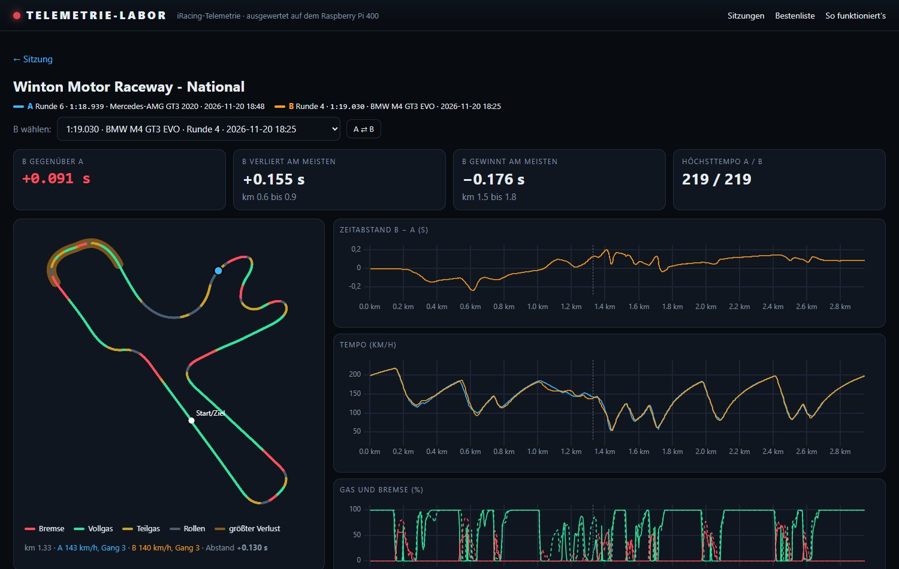
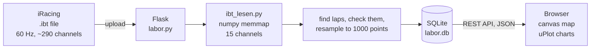

<p align="right"><a href="README.md">English</a> · <a href="README.de.md">Deutsch</a></p>

# Own project: telemetry lab



A web service on the Raspberry Pi 400 that analyses telemetry from the iRacing simulator. You upload an `.ibt` file in the browser. The Pi splits it into laps, checks every lap and stores the traces in SQLite. Two laps can then be overlaid: track map, speed, throttle, brake, gear and steering, plus the time gap at every point of the track.

The task was to use the Pi for something of our own. The lab is software only, no parts needed, and it can be presented in a browser without the simulator in the room.

## How it works



- [`ibt_lesen.py`](ibt_lesen.py) reads the header with `struct`, turns the variable list into a numpy dtype and maps it over the file with `np.memmap`, so only 15 columns are read. A 476 MB race file is processed on the Pi in seconds.
- A lap ends when `LapDistPct` wraps from above 0.9 to below 0.1 while `Lap` increases; the crossing time is interpolated between two samples. Checked against iRacing's own lap times: at most 1 ms difference.
- Every lap is resampled to 1000 points along the track, so two laps compare point by point; the time gap is `t_B − t_A`.
- Laps are invalid when the car was in the pit lane, off track for more than half a second, not on track, or the recording has a gap.

## Design and status bar

The "pit wall" theme is dark like a race engineer's monitors, with signal red as accent. Numbers use JetBrains Mono so lap times line up; the fastest lap is purple as in TV timing, and every chart has a one-line "So lesen" (how to read) hint for the audience. All colours are CSS variables in [`style.css`](static/style.css), which the map and charts read as well. Fonts (Barlow, Barlow Condensed, JetBrains Mono, SIL OFL) are bundled in [`static/schrift/`](static/schrift/). A status bar shows live Pi health every 10 s: CPU temperature, load, RAM, uptime, database size and free SD space, read from `/sys` and `/proc` by `systemwerte` in [`labor.py`](labor.py).

The code carries markers `SCHRITT n von 21` (step n of 21) that follow one `.ibt` file from service start to finished chart; the German README lists all steps with file and function.

## Privacy and security

The session info in every `.ibt` lists names and customer IDs of every driver in the session. The lab only keeps track, length, session type and your own car; `.ibt` files are deleted after processing and are in `.gitignore`. Anyone on the network may view, but uploading and deleting need a login (without a password only on the Pi itself). `python3 labor.py passwort` stores a PBKDF2 hash in `.env.password` (mode 600), which is git-ignored and watched by the commit guard.

## Setup on the Pi

```bash
bash einrichten.sh                 # packages, .env, systemd service
python3 labor.py passwort          # set your own password
sudo systemctl restart telemetrie-labor
```

Open `http://<pi-ip>:5080`. Tests: `python3 test_labor.py` builds its own `.ibt` in the real format and runs 28 checks (28 of 28 on the Pi). With 11 real files: 9 sessions, 110 laps, 565 km.
