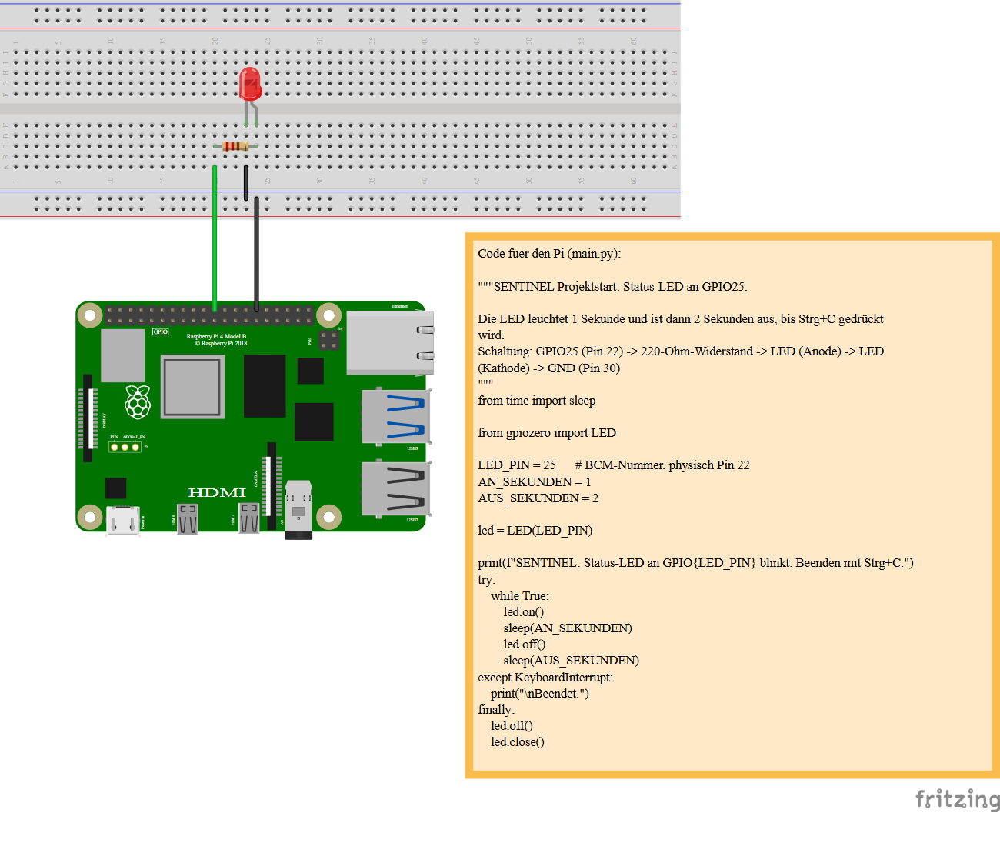
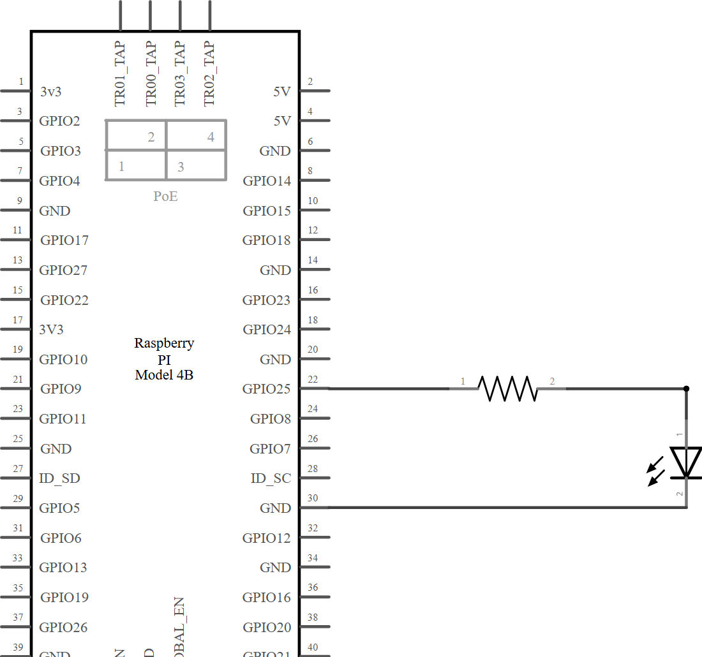
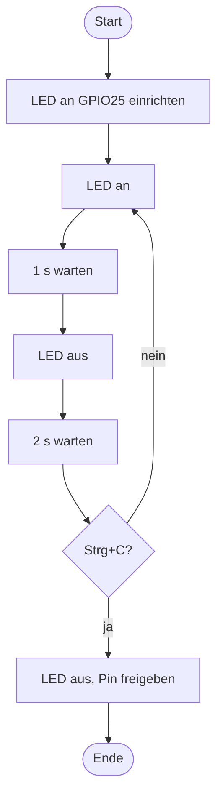

# 01 SENTINEL Projektstart

<p align="right"><a href="README.md">English</a> · <a href="README.de.md">Deutsch</a></p>

Der erste Baustein von SENTINEL ist eine Status-LED. Der Raspberry Pi schaltet sie über einen GPIO-Pin: 1 Sekunde an, 2 Sekunden aus. Später zeigt dieselbe LED an, ob das System läuft, eine Tür offen ist oder ein Alarm anliegt.



## Ziel

- Eine LED sicher an den GPIO-Header anschließen, mit Vorwiderstand und Rückweg zu GND.
- Die LED mit Python steuern: 1 s an, 2 s aus, bis das Programm beendet wird.
- Erkennbar daran, dass die LED im Takt blinkt und nach Strg+C aus ist.

## Hardware

| Bauteil | Anzahl | Hinweis |
|---|---|---|
| Raspberry Pi 400 (im Fritzing-Sketch: Pi 4B, gleicher 40-Pin-Header) | 1 | |
| LED rot, 5 mm | 1 | langes Bein = Anode (+) |
| Widerstand 220 Ω | 1 | im Miuzei-Kit Streifen "220R", Farbringe rot, rot, schwarz, schwarz, braun |
| Steckbrett | 1 | |
| Jumperkabel | 3 | grün = Signal, schwarz = GND |

## Pinbelegung

| Bauteil | GPIO (BCM) | Physischer Pin |
|---|---|---|
| LED über 220 Ω | GPIO25 | 22 |
| GND | | 30 |

Der Stromweg: GPIO25 → 220 Ω → LED-Anode → LED-Kathode → GND.

| Kabel / Bauteil | von | nach |
|---|---|---|
| Wire1 (grün) | Pin 22, GPIO25 | Steckbrett 20A |
| R1 220 Ω | 20C | 24C |
| LED1 Anode | 24E | |
| LED1 Kathode | 23E | |
| Wire2 (schwarz) | 23A | GND-Schiene (blaue Linie) |
| Wire3 (schwarz) | Pin 30, GND | GND-Schiene |

Schaltplan: [schaltplan/01-led-gpio25_schaltplan.png](schaltplan/01-led-gpio25_schaltplan.png) · Fritzing-Datei: [01-led-gpio25.fzz](schaltplan/01-led-gpio25.fzz)



## Starten

```bash
cd projekte/01-sentinel-projektstart
python3 main.py
```

Beenden mit <kbd>Strg</kbd> + <kbd>C</kbd>. Das Programm schaltet die LED danach aus.

## So funktioniert es

`LED(25)` reserviert GPIO25 als Ausgang. `led.on()` legt 3,3 V an den Pin, Strom fließt durch Widerstand und LED zurück zu GND, die LED leuchtet. `led.off()` setzt den Pin auf 0 V, es fließt kein Strom. `sleep()` hält das Programm für die angegebene Zeit an. `while True` wiederholt das endlos.

Strg+C löst eine `KeyboardInterrupt`-Ausnahme aus. Der `finally`-Block schaltet die LED dann aus und gibt den Pin frei, damit sie nicht zufällig an bleibt.



### Warum 220 Ω

Der GPIO liefert 3,3 V, die rote LED braucht etwa 2,0 V. Am Widerstand fallen 1,3 V ab:

I = U / R = 1,3 V / 220 Ω ≈ 6 mA

Das ist gut hell und liegt weit unter den etwa 16 mA, die ein GPIO-Pin verträgt.

## Test

| Testfall | Erwartet | Ergebnis |
|---|---|---|
| Schaltung in Fritzing prüfen | geschlossener Kreis GPIO25 → R1 → LED → GND, keine offenen Luftlinien | ✅ |
| LED-Polung | langes Bein am Widerstand, kurzes an GND | ✅ (Fritzing) |
| `python3 main.py` am Pi | LED 1 s an, 2 s aus | ✅ |
| Strg+C drücken | Meldung "Beendet.", LED aus | ✅ |

## Sicherheit

- Jede LED bekommt einen Vorwiderstand. Ohne ihn steigt der Strom stark an und kann LED oder GPIO beschädigen.
- Die GPIOs arbeiten mit 3,3 V. Keine 5 V an einen GPIO legen.
- Beim Umstecken ist der Pi ausgeschaltet.
- Kein Signal auf die Versorgungsschienen legen. Die Schienen sind für GND und 3,3 V.

## Was ich gelernt habe

- Strom fließt nur im geschlossenen Kreis. In meinem ersten Entwurf fehlte der Rückweg zu GND, die LED wäre dunkel geblieben.
- GPIO-Nummer und Pinnummer sind zwei verschiedene Dinge: GPIO25 sitzt auf Pin 22. Der Befehl `pinout` am Pi zeigt die Zuordnung.
- Im Fritzing-Schaltplan sind gestrichelte Linien nur Luftlinien. Erst echte Leitungen machen den Plan lesbar.
