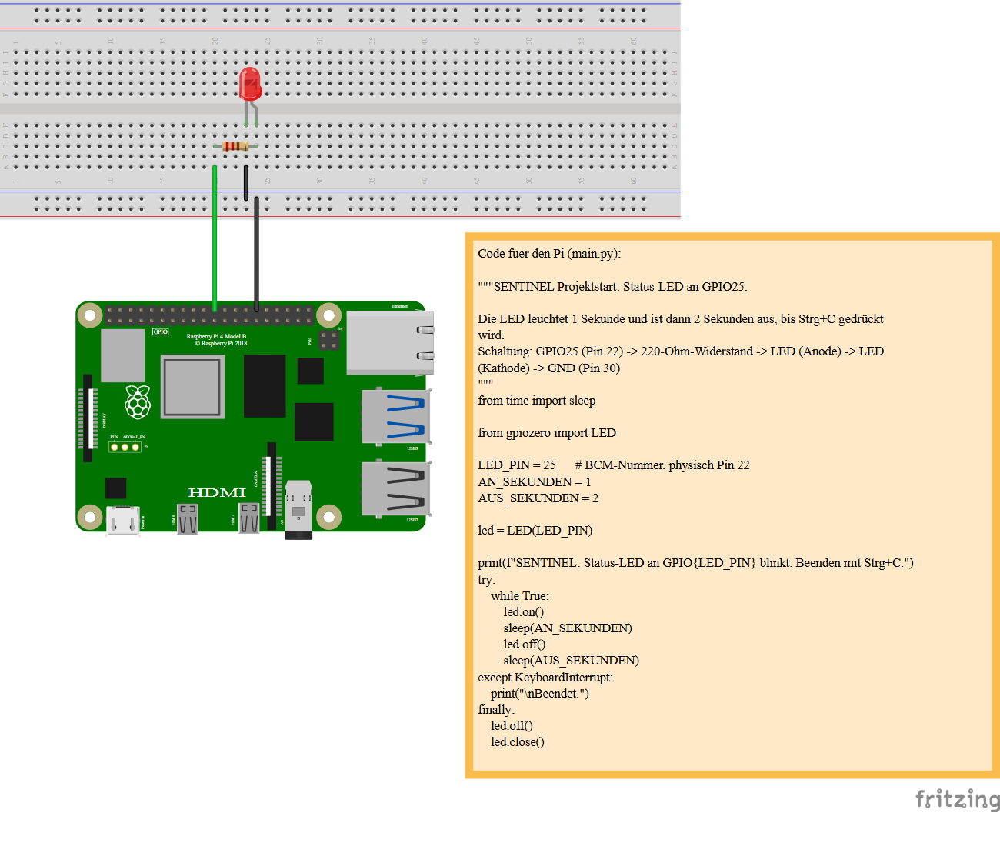
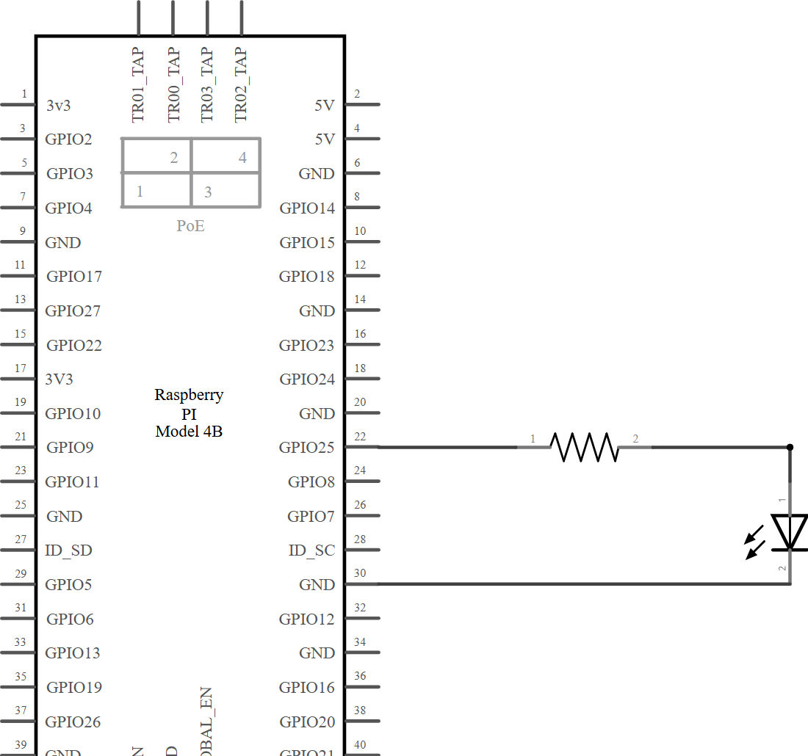
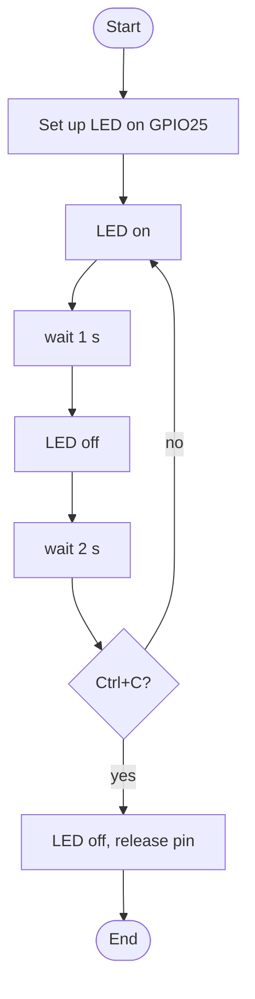

# 01 SENTINEL kickoff

<p align="right"><a href="README.md">English</a> · <a href="README.de.md">Deutsch</a></p>

The first building block of SENTINEL is a status LED. The Raspberry Pi switches it through a GPIO pin: on for 1 second, off for 2 seconds. Later the same LED will show whether the system is running, a door is open or an alarm is active.



## Goal

- Connect an LED safely to the GPIO header, with a series resistor and a return path to GND.
- Control the LED from Python: 1 s on, 2 s off, until the program is stopped.
- Done when the LED blinks in that rhythm and is off after Ctrl+C.

## Hardware

| Part | Qty | Note |
|---|---|---|
| Raspberry Pi 400 (Pi 4B in the Fritzing sketch, same 40-pin header) | 1 | |
| Red LED, 5 mm | 1 | long leg = anode (+) |
| Resistor 220 Ω | 1 | strip "220R" in the Miuzei kit, bands red, red, black, black, brown |
| Breadboard | 1 | |
| Jumper wires | 3 | green = signal, black = GND |

## Pinout

| Part | GPIO (BCM) | Physical pin |
|---|---|---|
| LED via 220 Ω | GPIO25 | 22 |
| GND | | 30 |

Current path: GPIO25 → 220 Ω → LED anode → LED cathode → GND.

| Wire / part | from | to |
|---|---|---|
| Wire1 (green) | pin 22, GPIO25 | breadboard 20A |
| R1 220 Ω | 20C | 24C |
| LED1 anode | 24E | |
| LED1 cathode | 23E | |
| Wire2 (black) | 23A | GND rail (blue line) |
| Wire3 (black) | pin 30, GND | GND rail |

Schematic: [docs/schaltplaene/01-led-gpio25_schaltplan.png](../../docs/schaltplaene/01-led-gpio25_schaltplan.png) · Fritzing file: [01-led-gpio25.fzz](../../docs/schaltplaene/01-led-gpio25.fzz)



## Run

```bash
cd projekte/01-sentinel-projektstart
python3 main.py
```

Stop with <kbd>Ctrl</kbd> + <kbd>C</kbd>. The program then switches the LED off.

## How it works

`LED(25)` claims GPIO25 as an output. `led.on()` puts 3.3 V on the pin, current flows through the resistor and the LED back to GND, and the LED lights up. `led.off()` sets the pin to 0 V and no current flows. `sleep()` pauses the program, and `while True` repeats forever.

Ctrl+C raises a `KeyboardInterrupt`. The `finally` block then switches the LED off and releases the pin, so it is never left on by accident.



### Why 220 Ω

The GPIO supplies 3.3 V and the red LED needs about 2.0 V, so 1.3 V drops across the resistor:

I = U / R = 1.3 V / 220 Ω ≈ 6 mA

That is nicely bright and well below the roughly 16 mA a GPIO pin can handle.

## Test

| Test case | Expected | Result |
|---|---|---|
| Check circuit in Fritzing | closed loop GPIO25 → R1 → LED → GND, no open ratsnest lines | ✅ |
| LED polarity | long leg at the resistor, short leg at GND | ✅ (Fritzing) |
| `python3 main.py` on the Pi | LED 1 s on, 2 s off | ⬜ tick on the Pi |
| Press Ctrl+C | message "Beendet.", LED off | ⬜ tick on the Pi |

## Safety

- Every LED gets a series resistor. Without it the current rises sharply and can damage the LED or the GPIO.
- The GPIOs run at 3.3 V. Never put 5 V on a GPIO.
- Power the Pi off before rewiring.
- Keep signals off the power rails. The rails are for GND and 3.3 V.

## What I learned

- Current only flows in a closed loop. My first draft had no return path to GND, so the LED would have stayed dark.
- GPIO number and pin number are different things: GPIO25 sits on pin 22. Running `pinout` on the Pi shows the mapping.
- Dashed lines in the Fritzing schematic are only ratsnest lines. Real wires make the schematic readable.
