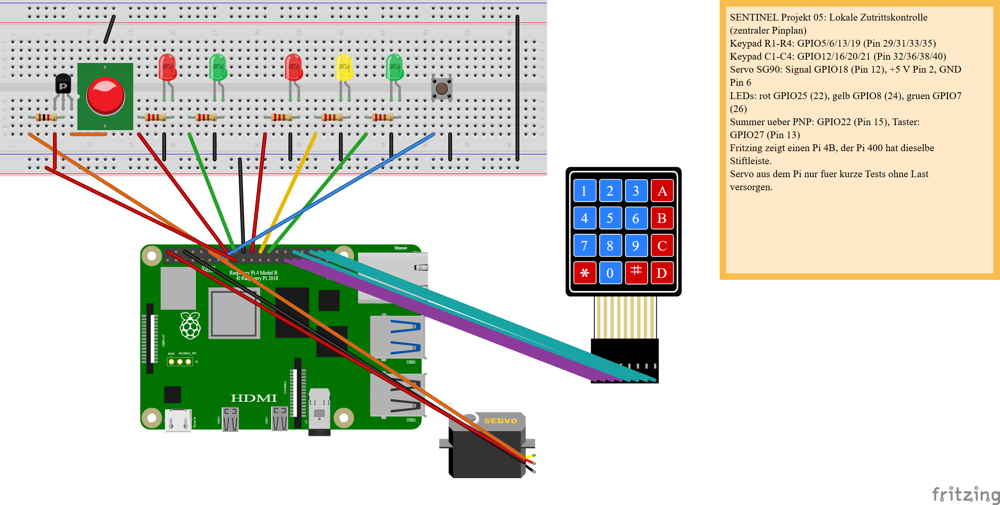

<p align="right"><a href="README.md">English</a> · <a href="README.de.md">Deutsch</a></p>

# 05 Local access control

Type a PIN on the 4x4 keypad, `#` checks it. Correct: green, two beeps, the SG90 servo moves from 0° to 90°, holds 3 s and returns. Wrong: red for 1 s, the servo does not move.

## Wiring

| Part | GPIO (BCM) | Physical pin |
|---|:-:|:-:|
| Keypad R1 bis R4 | GPIO5, 6, 13, 19 | 29, 31, 33, 35 |
| Keypad C1 bis C4 | GPIO12, 16, 20, 21 | 32, 36, 38, 40 |
| Servo Signal | GPIO18 | 12 |
| Servo +5 V / GND | 5 V / GND | 2 / 6 |
| LEDs rot, gelb, grün | GPIO25, 8, 7 | 22, 24, 26 |
| Summer / buzzer | GPIO22 | 15 |

All pins come from the [central pinout](../README.md#central-pinout).



Fritzing file: [schaltplan/05-zutritt-servo.fzz](schaltplan/05-zutritt-servo.fzz). It is based on my day 5 exercise sketch: buzzer, button and keypad column C1 are rewired, the servo is new. Fritzing shows a Pi 4B, the Pi 400 has the same header. Servo wire colours follow the SG90: orange signal, red +5 V, brown GND.

## Run

```bash
cd projekte/05-lokale-zutrittskontrolle
cp config.example.ini config.ini   # einmalig, Test-PIN eintragen
python3 zutritt_lokal.py
python3 zutritt_lokal.py --mqtt     # meldet granted/denied
```

## How it works

- The keypad is scanned every 20 ms: each row HIGH in turn, columns read. Several keys pressed at once are rejected.
- PIN entry is a state machine: at most 4 digits, `*` deletes the last one, `#` only checks exactly 4 digits, 10 s without a key clears everything.
- The servo starts in the locked position and then gets no signal (`detach`). With `pigpiod` running, pulses are hardware-timed, otherwise software PWM is used.
- The check is a replaceable function `verify_pin(pin)`. Here it compares with the test PIN from `config.ini`, in project 06 with MariaDB and Argon2. Scanner and servo stay the same.
- The PIN never appears in the terminal, a log or MQTT. Only `granted`, `denied` or `technical_error` is sent.

## Tests

Automatic on the Pi: `test_zutritt_lokal.py`: 15 checks for ZT-01 to ZT-05 and ZT-07, keypad scan and servo sequence with simulated pins. All passing.

With real hardware (still open):

| Test | Expected | Result |
|---|---|:-:|
| richtige PIN + `#` | grün, 2 Pieptöne, Servo 0° → 90° → 3 s → 0° | ⬜ |
| falsche PIN + `#` | rot 1 s, kein Servo | ⬜ |
| 3 Ziffern + `#` | zweimal rot blinken, keine Prüfung | ⬜ |
| 5 Ziffern | fünfte wird ignoriert | ⬜ |
| 2 Ziffern, 10 s warten | Eingabe gelöscht | ⬜ |
| Strg+C | Servo verriegelt, alles aus | ⬜ |

## Files

| File | Purpose |
|---|---|
| [`zutritt_lokal.py`](zutritt_lokal.py) | Programm mit lokaler PIN-Prüfung |
| [`config.example.ini`](config.example.ini) | Vorlage, `config.ini` selbst ist per `.gitignore` ausgeschlossen |
| [`test_zutritt_lokal.py`](test_zutritt_lokal.py) | automatischer Test |
| [`schaltplan/`](schaltplan/) | Fritzing sketch and breadboard image |

Every line of code has a German comment explaining what it does and why it is there.

## Limits

The plain-text PIN in `config.ini` is a deliberately insecure learning step per the worksheet. Project 06 replaces it. Powering the servo from the Pi is only fine for short tests without load.
