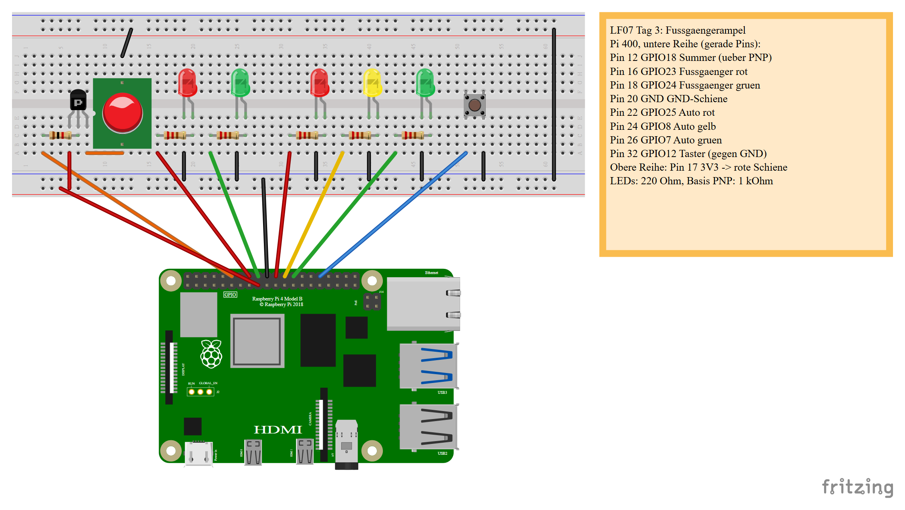
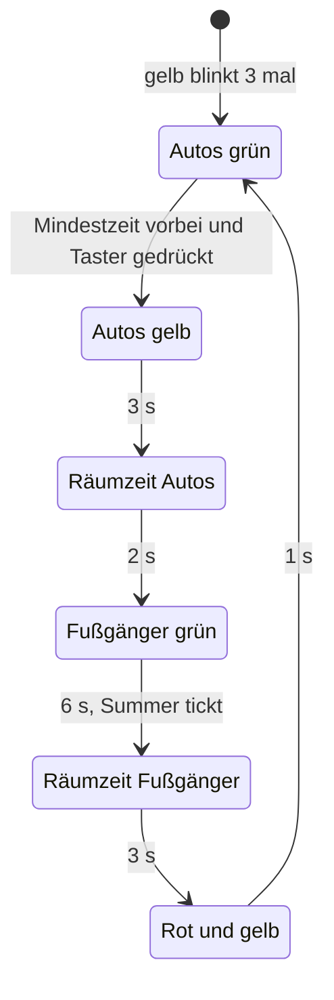

<p align="right"><a href="README.md">English</a> · <a href="README.de.md">Deutsch</a></p>

# Übung Tag 3: Fußgängerampel

Eine Autoampel und eine Fußgängerampel am Raspberry Pi 400. Ein Taster fordert Grün für Fußgänger an, ein Summer tickt während der Grünphase als Signal für blinde Menschen. Vorlage war das Ampelprojekt im Raspberry-Pi-Handbuch (S. 142). Diese Fassung läuft in Python, folgt der deutschen Phasenfolge und hat Räumzeiten.



## Pinbelegung

| Bauteil | GPIO (BCM) | Physischer Pin |
|---|---|---|
| Summer über PNP-Transistor S8550, 1 kΩ an der Basis | GPIO18 | 12 |
| Fußgänger rot | GPIO23 | 16 |
| Fußgänger grün | GPIO24 | 18 |
| GND-Schiene | GND | 20 |
| Auto rot | GPIO25 | 22 |
| Auto gelb | GPIO8 | 24 |
| Auto grün | GPIO7 | 26 |
| Taster gegen GND | GPIO12 | 32 |
| Emitter des Transistors | 3V3 | 17 |

Jede LED hat einen Vorwiderstand von 220 Ω. GPIO14 und GPIO15 bleiben frei, weil dort auf diesem Pi die serielle Konsole läuft.

## Starten

```bash
cd uebungen/tag03-fussgaengerampel
python3 ampel.py
```

## Ablauf



## Tests

| Test | Erwartung | Ergebnis |
|---|---|---|
| Simulation mit gpiozero-Mock-Pins | richtige Phasenfolge, nie gleichzeitig grün für Autos und Fußgänger | ✅ |
| Aufbau am Pi | wie im Ablauf oben | ✅ |
