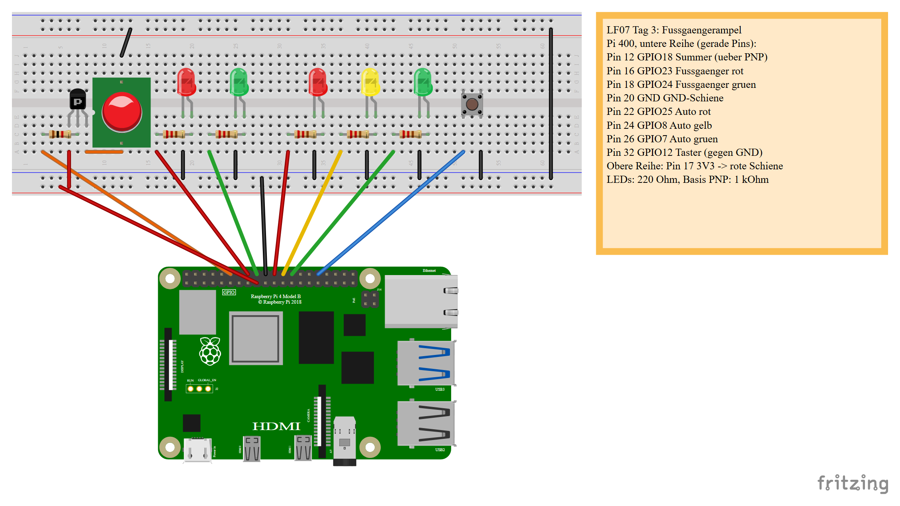

<p align="right"><a href="README.md">English</a> · <a href="README.de.md">Deutsch</a></p>

# Exercise day 3: pedestrian crossing

A traffic light for cars and a pedestrian light on the Raspberry Pi 400. A push button requests green for pedestrians, and a buzzer ticks during their green phase as a signal for blind people. It is based on the traffic light project in the official Raspberry Pi Beginner's Guide (p. 142), rewritten in Python with the German light sequence and clearance phases.



## Pin mapping

| Component | GPIO (BCM) | Physical pin |
|---|---|---|
| Buzzer via S8550 PNP transistor, 1 kΩ on the base | GPIO18 | 12 |
| Pedestrian red | GPIO23 | 16 |
| Pedestrian green | GPIO24 | 18 |
| Ground rail | GND | 20 |
| Car red | GPIO25 | 22 |
| Car amber | GPIO8 | 24 |
| Car green | GPIO7 | 26 |
| Button to GND | GPIO12 | 32 |
| Transistor emitter | 3V3 | 17 |

Every LED has a 220 Ω series resistor. GPIO14 and GPIO15 stay free because this Pi runs its serial console there.

## Run it

```bash
cd uebungen/tag03-fussgaengerampel
python3 ampel.py
```

## Tests

| Test | Expected | Result |
|---|---|---|
| Simulation with gpiozero mock pins | correct sequence, cars and pedestrians never green at the same time | ✅ |
| Hardware on the Pi | same sequence as above | ⬜ |
