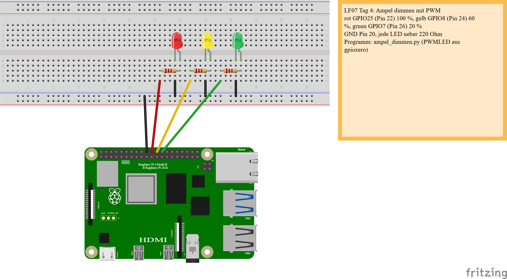
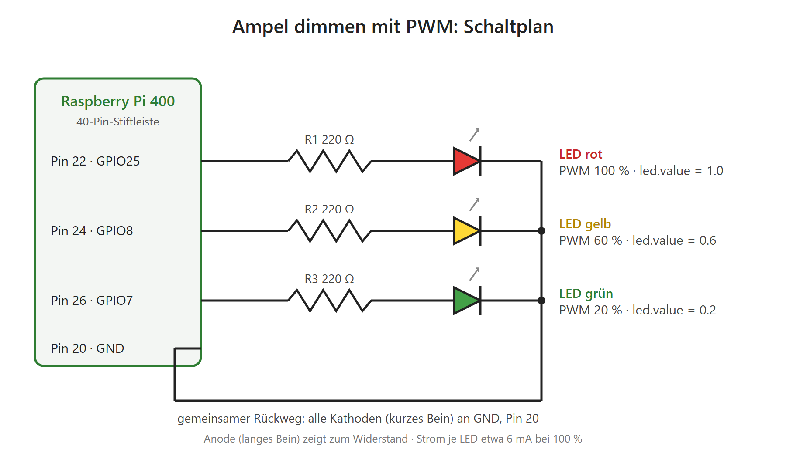

# 01 Ampel dimmen: Anbauleitung, einfach erklärt

- Lernfeld: LF07 Cyber-physische Systeme ergänzen
- Tag: 4
- Datum: 19.11.2026
- Lernhöhe: Einstieg, Schritt für Schritt
- Arbeitsform: Einzelarbeit am eigenen Pi 400

## Aufgabenstellung

Drei LEDs in Ampelfarben sollen so an den Pi 400 gesteckt werden, dass das Programm ampel_dimmen.py sie unterschiedlich hell leuchten lassen kann: rot 100 %, gelb 60 %, grün 20 %. Die Anleitung soll so einfach sein, dass man sie ohne Vorwissen nachbauen kann.

## Lösung

### Worum es geht, ganz einfach

Stell dir vor, du knipst eine Taschenlampe ganz schnell an und aus, hundertmal in einer Sekunde. Dein Auge kommt da nicht mit und sieht kein Flackern. Es sieht nur: Die Lampe ist etwas dunkler. Je länger sie in jedem kurzen Moment an ist, desto heller wirkt sie. Genau das macht der Pi mit unseren LEDs. Rot ist immer an, gelb ist etwas mehr als die Hälfte der Zeit an, grün nur ganz kurz.

Für das Stecken heißt das: Die Schaltung ist ganz normal. Jede LED hängt mit einem Widerstand an einem eigenen Pin. Das Dimmen passiert nur im Programm.

### Schritt 1: Hast du die Ampel von Tag 3 noch stecken?

Ja: Dann bist du fast fertig. Das Programm nutzt genau die drei Autolampen von damals (rot an Pin 22, gelb an Pin 24, grün an Pin 26). Fußgängerlampen, Taster und Summer dürfen stecken bleiben, sie bleiben einfach aus. Spring weiter zu Schritt 5.

Nein: Dann baust du die drei LEDs neu auf. Weiter mit Schritt 2.

### Schritt 2: Diese Teile brauchst du

| Teil | Anzahl | Woran man es erkennt |
|---|---|---|
| LED rot | 1 | ein Bein ist länger, das lange ist Plus |
| LED gelb | 1 | wie oben |
| LED grün | 1 | wie oben |
| Widerstand 220 Ohm | 3 | Farbringe rot, rot, schwarz, schwarz, braun |
| Kabel Buchse auf Stift | 4 | ein Ende hat ein Loch (kommt auf den Pi), das andere einen Stift (kommt ins Steckbrett) |
| Kabel Stift auf Stift | 3 | an beiden Enden ein Stift |
| Steckbrett | 1 | weißes Brett mit vielen Löchern |

Pass bei den Widerständen auf: Im Kit gibt es auch 1 kOhm (braun, schwarz, schwarz, braun, braun) und 10 kOhm (braun, schwarz, schwarz, rot, braun). Damit leuchten die LEDs kaum, und der Unterschied zwischen den Stufen ist nicht zu sehen.

### Schritt 3: Pi ausschalten

Pi herunterfahren und das USB-C-Kabel ziehen. Gesteckt wird nur ohne Strom. Ein Kabel am falschen Pin kann sonst den Pi beschädigen.

### Schritt 4: Stecken

So funktioniert das Steckbrett: Die fünf Löcher A bis E in einer Spalte sind innen miteinander verbunden. Was in Spalte 10 steckt, ist also elektrisch dasselbe, egal ob in Reihe A oder E. Die lange Lochreihe direkt unter Reihe A ist die Minus-Schiene. Alle Löcher darin sind verbunden. Dort sammeln wir GND, also den Rückweg für den Strom. Fritzing nennt diese Schiene X.

Die vier Pins am Pi, die wir brauchen (20, 22, 24, 26), sitzen direkt nebeneinander in derselben Reihe der Stiftleiste. Wenn du unsicher bist, welcher Pin welcher ist: Im Terminal am Pi `pinout` eingeben, das zeigt eine Karte.

Jede LED wird nach demselben Muster gesteckt: Kabel vom Pi, dann Widerstand, dann LED, dann zurück zur Minus-Schiene. So sieht das fertig aus:



Und so als Schaltplan, mit allen drei Zweigen nebeneinander:



Die Fritzing-Datei liegt unter [schaltplan/ampel-dimmen.fzz](schaltplan/ampel-dimmen.fzz). Fritzing zeigt einen Pi 4B, der Pi 400 hat dieselbe Stiftleiste.

| Nr. | Teil | Steckt von | nach |
|---|---|---|---|
| 1 | Kabel Buchse auf Stift, am besten schwarz | Pi Pin 20 (GND) | Minus-Schiene, Spalte 28 |
| 2 | Kabel Buchse auf Stift, am besten rot | Pi Pin 22 (GPIO25) | Spalte 31, Reihe A |
| 3 | Widerstand 220 Ohm | Spalte 31, Reihe C | Spalte 35, Reihe C |
| 4 | LED rot, langes Bein | Spalte 35, Reihe E | |
| 5 | LED rot, kurzes Bein | Spalte 34, Reihe E | |
| 6 | Kabel Stift auf Stift, schwarz | Spalte 34, Reihe A | Minus-Schiene |
| 7 | Kabel Buchse auf Stift, am besten gelb | Pi Pin 24 (GPIO8) | Spalte 37, Reihe A |
| 8 | Widerstand 220 Ohm | Spalte 37, Reihe C | Spalte 41, Reihe C |
| 9 | LED gelb, langes Bein | Spalte 41, Reihe E | |
| 10 | LED gelb, kurzes Bein | Spalte 40, Reihe E | |
| 11 | Kabel Stift auf Stift, schwarz | Spalte 40, Reihe A | Minus-Schiene |
| 12 | Kabel Buchse auf Stift, am besten grün | Pi Pin 26 (GPIO7) | Spalte 43, Reihe A |
| 13 | Widerstand 220 Ohm | Spalte 43, Reihe C | Spalte 47, Reihe C |
| 14 | LED grün, langes Bein | Spalte 47, Reihe E | |
| 15 | LED grün, kurzes Bein | Spalte 46, Reihe E | |
| 16 | Kabel Stift auf Stift, schwarz | Spalte 46, Reihe A | Minus-Schiene |

Der Strom läuft bei rot so: Pin 22, Kabel, Spalte 31, Widerstand, Spalte 35, LED, Spalte 34, Kabel, Minus-Schiene, Pin 20. Bei gelb und grün ist es genauso, nur 6 und 12 Spalten weiter rechts. Das sind genau die Spalten der Autoampel von Tag 3.

Beim Widerstand ist die Richtung egal. Bei der LED nicht: Das lange Bein gehört immer zum Widerstand, das kurze zur Minus-Seite. Steckt die LED falsch herum, bleibt sie einfach dunkel. Kaputt geht dabei nichts.

### Schritt 5: Vor dem Einschalten prüfen

| Prüfpunkt | Erledigt |
|---|---|
| Schwarzes Kabel von Pin 20 steckt in der Minus-Schiene unter Reihe A | ✅ |
| Rot an Pin 22, gelb an Pin 24, grün an Pin 26 | ✅ |
| Kein Kabel an Pin 2 oder Pin 4, dort liegen 5 V | ✅ |
| Bei jeder LED steckt das lange Bein in derselben Spalte wie der Widerstand | ✅ |
| Alle drei Widerstände haben die Ringe rot, rot, schwarz, schwarz, braun | ✅ |

### Schritt 6: Programm starten

Pi einschalten. In VS Code das Terminal Raspberry Pi öffnen und eingeben:

```bash
cd ~/lf07-cyber-physische-systeme
git pull
cd uebungen/tag04-ampel-dimmen
python3 ampel_dimmen.py
```

`git pull` holt vorher den neuesten Stand von GitHub, damit das Programm überhaupt auf dem Pi ist.

Das solltest du sehen: Rot leuchtet hell, dann gelb etwas schwächer, dann grün nur noch schwach. Danach leuchten alle drei zusammen, und man sieht die drei Stufen nebeneinander. Mit Strg+C hörst du auf, dann gehen alle Lampen aus.

### Wenn etwas nicht klappt

| Was passiert | Woran es liegt | Was du tust |
|---|---|---|
| Eine LED bleibt dunkel | LED falsch herum oder Kabel am falschen Pin | Pi aus, LED umdrehen, Pin mit `pinout` prüfen |
| Alle LEDs bleiben dunkel | GND fehlt | Kabel von Pin 20 zur Minus-Schiene prüfen |
| Grün sieht fast so hell aus wie gelb | Das Auge nimmt kleine Helligkeiten stärker wahr | Technisch alles richtig. Zum Testen GRUEN_HELLIGKEIT im Programm auf 0.05 setzen |
| Summer von Tag 3 piept die ganze Zeit | Der Summer-Pin ist ohne Programm nicht festgelegt | Pi aus, Kabel an Pin 12 ziehen |
| Fehlermeldung "GPIO busy" oder ähnlich | Ein anderes Programm benutzt die Pins noch | Das andere Programm mit Strg+C beenden, dann neu starten |
