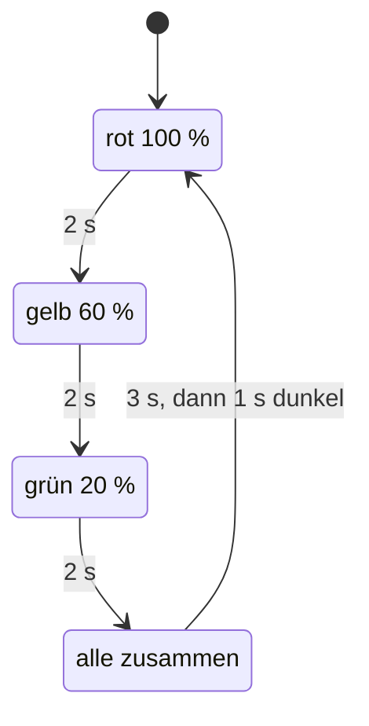

<p align="right"><a href="README.md">English</a> · <a href="README.de.md">Deutsch</a></p>

# Übung Tag 4: Ampel dimmen mit PWM

Die drei Autolampen der Ampel leuchten nacheinander, jede schwächer als die davor: rot mit 100 %, gelb mit 60 %, grün mit 20 %. Danach leuchten alle drei zusammen, so dass man die Stufen direkt vergleichen kann.

## Wie das Dimmen funktioniert

Ein GPIO-Pin kann nur 3,3 V oder 0 V. Für Zwischenstufen schaltet der Pi die LED 100 Mal pro Sekunde an und aus (PWM, Pulsweitenmodulation). Das Auge sieht das Flackern nicht, nur den Durchschnitt. Bei 60 % ist die LED in jedem 10-ms-Takt 6 ms an, bei 20 % nur 2 ms.

In gpiozero übernimmt das die Klasse `PWMLED`. Die Helligkeit ist eine Zahl von 0.0 bis 1.0:

```python
gelb = PWMLED(8)
gelb.value = 0.6   # 60 %
```

## Pinbelegung

Gleiche Verkabelung wie die Autoampel aus der [Fußgängerampel](../tag03-fussgaengerampel/). Wer sie noch stecken hat, muss nichts umbauen.

| Lampe | GPIO (BCM) | Physischer Pin | Helligkeit |
|---|---|---|---|
| rot | GPIO25 | 22 | 100 % |
| gelb | GPIO8 | 24 | 60 % |
| grün | GPIO7 | 26 | 20 % |
| GND-Schiene | GND | 20 | |

Jede LED hat einen Vorwiderstand von 220 Ω. Die Schritt-für-Schritt-Anleitung mit Steckbrett-Spalten steht in der [Anbauleitung](ANBAULEITUNG.de.md).

## Starten

```bash
cd uebungen/tag04-ampel-dimmen
python3 ampel_dimmen.py
```

Beenden mit Strg+C, danach sind alle Lampen aus.

## Ablauf



## Gut zu wissen

Grün mit 20 % wirkt heller als ein Fünftel. Das Auge reagiert auf kleine Lichtmengen stärker als auf große, und LED-Farben sind bei gleichem Strom unterschiedlich hell. Der Pin ist trotzdem genau 20 % der Zeit an. Die Werte stehen als Konstanten oben in `ampel_dimmen.py` und lassen sich dort ändern.

## Tests

| Test | Erwartung | Ergebnis |
|---|---|---|
| Simulation mit gpiozero-Mock-Pins am Pi | richtige Reihenfolge und Werte, Strg+C beendet sauber | ✅ |
| Aufbau am Pi | rot hell, gelb schwächer, grün deutlich schwächer | ⬜ |
| Strg+C | Meldung "Beendet.", alle Lampen aus | ⬜ |
