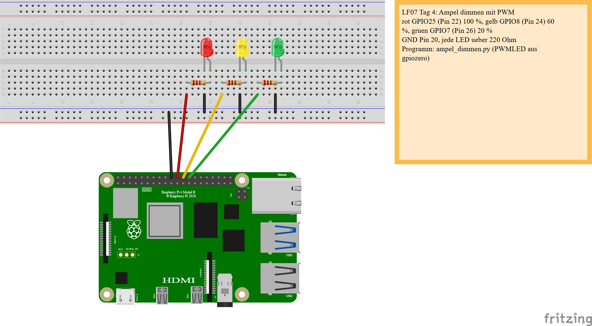
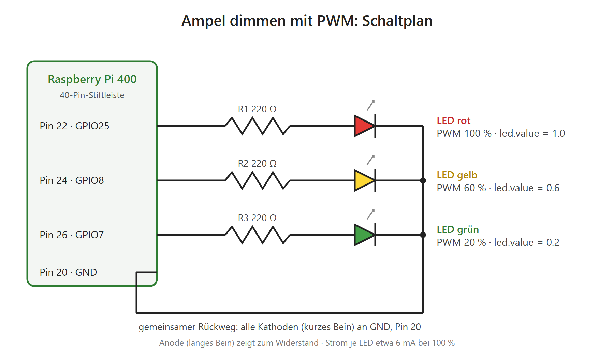
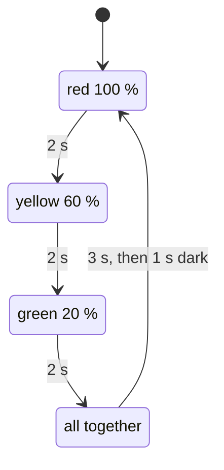

<p align="right"><a href="README.md">English</a> · <a href="README.de.md">Deutsch</a></p>

# Exercise day 4: dimming the traffic light with PWM



The three car lights glow one after another, each dimmer than the one before: red at 100 %, yellow at 60 %, green at 20 %. Then all three light up together so the levels can be compared side by side.

## How dimming works

A GPIO pin only knows 3.3 V or 0 V. To get levels in between, the Pi switches the LED on and off 100 times per second (PWM, pulse width modulation). The eye does not see the flicker, only the average. At 60 % the LED is on for 6 ms of every 10 ms cycle, at 20 % only for 2 ms.

In gpiozero the `PWMLED` class handles this. Brightness is a number from 0.0 to 1.0:

```python
gelb = PWMLED(8)
gelb.value = 0.6   # 60 %
```

## Pinout

Same wiring as the car lights of the [pedestrian crossing](../tag03-fussgaengerampel/). If that is still on the breadboard, nothing needs to change.

| Light | GPIO (BCM) | Physical pin | Brightness |
|---|---|---|---|
| red | GPIO25 | 22 | 100 % |
| yellow | GPIO8 | 24 | 60 % |
| green | GPIO7 | 26 | 20 % |
| ground rail | GND | 20 | |

Every LED has a 220 Ω series resistor. A step-by-step build guide with breadboard columns is in the [build guide (German)](ANBAULEITUNG.de.md).



Fritzing file: [schaltplan/ampel-dimmen.fzz](schaltplan/ampel-dimmen.fzz). Fritzing shows a Pi 4B, the Pi 400 has the same header.

## Run

```bash
cd uebungen/tag04-ampel-dimmen
python3 ampel_dimmen.py
```

Stop with Ctrl+C, after that all lights are off.

## Sequence



## Good to know

Green at 20 % looks brighter than a fifth. The eye reacts more strongly to small amounts of light than to large ones, and LED colours differ in brightness at the same current. The pin is still on for exactly 20 % of the time. The values are constants at the top of `ampel_dimmen.py` and can be changed there.

## Tests

| Test | Expected | Result |
|---|---|---|
| Simulation with gpiozero mock pins on the Pi | correct order and values, Ctrl+C exits cleanly | ✅ |
| Hardware on the Pi | red bright, yellow dimmer, green clearly dimmer | ✅ |
| Ctrl+C | message "Beendet.", all lights off | ✅ |
