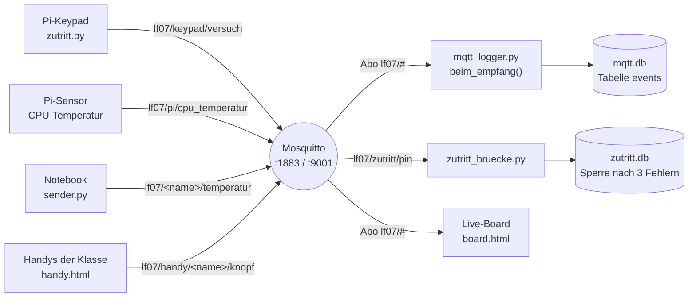

<p align="right"><a href="README.md">English</a> · <a href="README.de.md">Deutsch</a></p>

# Übung Tag 5: SENTINEL Funk (MQTT, Mosquitto, SQLite)


## Aufgabe (Wortlaut vom Dozenten)

> Ein Sender sendet Daten (was auch immer, physische Daten, Eingabe des Users etc.). Mosquitto empfängt das Event von seinem Client (es reicht ein Client, aber gerne mehr). Eine Funktion macht eine Subscription auf dieses Topic und schreibt den Wert und die Zeit in eine DB. Bitte 10 bis 20 Events produzieren, gerne mehr.

## Lösung in einem Satz

Mehrere Clients schicken Events an den Broker Mosquitto auf dem Pi. Die Funktion `beim_empfang()` in [`mqtt_logger.py`](mqtt_logger.py) hat `lf07/#` abonniert und schreibt jedes Event mit Zeit, Topic, Sender und Wert in die SQLite-Datei `mqtt.db`.

## Wie MQTT hier funktioniert

MQTT arbeitet nach dem Prinzip Publish/Subscribe. Ein Sender (Publisher) schickt eine Nachricht nicht direkt an einen Empfänger. Er gibt sie mit einem Topic beim Broker ab, so wie man einen Brief mit Adresse bei der Post einwirft. Der Broker reicht sie an alle weiter, die dieses Topic abonniert haben (Subscriber). Sender und Empfänger kennen sich nicht. Deshalb kann man jederzeit weitere Sender oder Empfänger dazunehmen, ohne etwas umzubauen.



| Teil der Aufgabe | Umsetzung |
|---|---|
| Sender mit physischen Daten | `sender.py --cpu` liest die echte CPU-Temperatur des Pi |
| Sender mit Eingabe des Users | Keypad (oder Tastatur) über `zutritt.py`, Handyseite, `sender.py` zum Tippen |
| Broker | Mosquitto 2.0 auf dem Pi, Port 1883 (MQTT) und 9001 (MQTT über WebSocket für Browser) |
| Funktion mit Subscription | `beim_empfang()` in `mqtt_logger.py`, Abo auf `lf07/#` |
| Wert und Zeit in eine DB | Tabelle `events` in `mqtt.db` (SQLite) |
| 10 bis 20 Events | `sender.py --anzahl 20` erzeugt 20 auf einen Schlag, dazu jedes Handy |

`#` im Topic ist ein Platzhalter: `lf07/#` heißt "alles, was mit lf07/ beginnt". So fängt ein einziges Abo alle Sender ein.

## Die Tabelle

```sql
CREATE TABLE events (
    id     INTEGER PRIMARY KEY AUTOINCREMENT,  -- laufende Nummer
    zeit   REAL    NOT NULL,                   -- Empfangszeit in Sekunden seit 1970
    topic  TEXT    NOT NULL,                   -- z. B. lf07/handy/lisa/knopf
    sender TEXT    NOT NULL DEFAULT '',        -- wer gesendet hat
    wert   TEXT    NOT NULL                    -- der Wert als Text
);
```

Die Zeit steht als Zahl in der Datenbank. Lesbar wird sie erst bei der Abfrage:

```bash
sqlite3 mqtt.db "SELECT id, datetime(zeit,'unixepoch','localtime'), topic, sender, wert FROM events ORDER BY id DESC LIMIT 20;"
```

## Der Wow-Teil

- **Live-Board** (`http://<Pi>:5050`): Jedes Event fliegt als leuchtendes Paket vom Sender zum Broker. Sobald der Logger es gespeichert hat, fliegt ein grünes Paket in die Datenbank-Tonne. Darunter läuft die echte Tabelle aus `mqtt.db` mit, samt der SQL-Abfrage. Bei 20 Events seit Start gibt es Konfetti und "20 EVENTS ✓".
- **Die Klasse macht mit:** Auf dem Board hängt ein QR-Code. Wer ihn scannt, wird mit dem Handy selbst zum MQTT-Client und kann Knöpfe drücken und einen Messwert schicken.
- **Knack den Tresor:** Auf dem Handy gibt es einen Ziffernblock. Die PIN geht per MQTT an die echte Zutrittskontrolle aus Tag 5. Nach drei falschen PINs sperrt SENTINEL. Das Board zeigt einen roten Alarm, das SENTINEL-Dashboard auf Port 5000 schaltet auf Lockdown, und läuft `zutritt.py`, geht am Pi die rote LED an.

## Vorführung

Einmalig auf dem Pi (Pakete, Mosquitto-Einstellung, Desktop-Symbol):

```bash
cd ~/lf07-cyber-physische-systeme/uebungen/tag05-mqtt
bash funk.sh einrichten
```

Vor der Vorführung:

1. `bash funk.sh neu` startet Logger, Brücke und Board mit leerer Tabelle. Alternativ Doppelklick auf "SENTINEL Funk" (dann ohne Leeren).
2. Am Board "Ton an" klicken, Board per RealVNC oder Beamer zeigen.
3. Die Klasse scannt den QR-Code. Handys und Pi müssen im selben WLAN sein.
4. Vom Notebook 20 Events nachschießen: `python sender.py --host <IP des Pi> --anzahl 20`
5. Echte Sensordaten: auf dem Pi `python3 sender.py --host localhost --cpu --anzahl 10`
6. Beweis aus der Datenbank: die `sqlite3`-Abfrage von oben im Terminal zeigen.

`bash funk.sh status` zeigt, was läuft und wie viele Events gespeichert sind. `bash funk.sh stopp` beendet alles.

## Auf dem Notebook

```powershell
pip install paho-mqtt
python sender.py --host 192.168.2.117 --anzahl 20
```

Die IP des Pi steht auf dem Board unter dem QR-Code. Im Heimnetz klappt oft auch `--host raspberrypi.local`.

## Dateien

| Datei | Aufgabe |
|---|---|
| [mqtt_logger.py](mqtt_logger.py) | Subscriber: `beim_empfang()` schreibt jedes Event in `mqtt.db` |
| [sender.py](sender.py) | Publisher für Pi und Notebook: Messreihe, CPU-Temperatur, Text |
| [zutritt_bruecke.py](zutritt_bruecke.py) | prüft PINs aus MQTT gegen `zutritt.db` und antwortet dem Handy |
| [funk_web.py](funk_web.py) | Flask auf Port 5050: liefert Board, Handyseite, QR-Code, Daten |
| [board.html](board.html) / [handy.html](handy.html) | Live-Board und Handyseite, beide selbst MQTT-Clients über WebSocket |
| [funk_db.py](funk_db.py) | gemeinsame Datenbank-Funktionen und MQTT-Client für paho 1.x und 2.x |
| [funk.sh](funk.sh) | einrichten, starten, stoppen, Status |
| [test_funk.py](test_funk.py) | 19 Prüfungen ohne Broker |
| static/mqtt.min.js | MQTT.js 4.3.7 für den Browser, liegt lokal, damit kein Internet nötig ist |

Außerdem meldet [`../tag05-zutrittskontrolle/zutritt.py`](../tag05-zutrittskontrolle/zutritt.py) jetzt jeden PIN-Versuch als `ok`, `falsch` oder `gesperrt` auf `lf07/keypad/versuch`. Die PIN selbst wird nie gesendet. Fehlt paho-mqtt oder läuft kein Broker, arbeitet die Zutrittskontrolle wie vorher.


## Getestet

- `python3 test_funk.py`: 19 von 19 Prüfungen bestanden, `test_zutritt.py` weiter grün.
- Live auf dem Pi mit Mosquitto 2.0.11: 20 Notebook-Werte, 3 CPU-Temperaturen, 3 falsche PINs mit Sperre und eine Keypad-Meldung, zusammen 30 Zeilen in `mqtt.db`.
- Handyseite in Edge mit Handygröße über WLAN: verbindet, sendet, bekommt die Sperr-Antwort.

## Grenzen

- Der Broker nimmt Verbindungen ohne Passwort und ohne Verschlüsselung an. Jeder im WLAN kann mitlesen und senden. Für die Vorführung im Schulnetz ist das in Ordnung. Im Betrieb gehören Benutzer, Passwörter (`password_file`) und TLS dazu.
- Eine PIN vom Handy geht im Klartext über das WLAN. Die Datenbank speichert nur `PIN ****`, das Board zeigt sie nie. Deshalb dort nie die echte Admin-PIN eintippen.
- Manche Schul-WLANs trennen Geräte voneinander (Client-Isolation). Dann erreichen die Handys den Pi nicht. Notebook und Pi-Sender funktionieren trotzdem, wenn das Notebook per LAN oder Tailscale dran ist.
