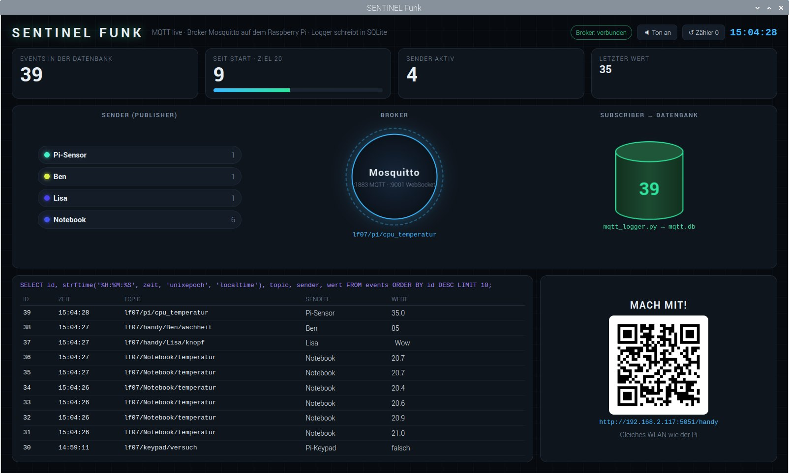

<p align="right"><a href="README.md">English</a> · <a href="README.de.md">Deutsch</a></p>

# Exercise day 5: SENTINEL radio (MQTT, Mosquitto, SQLite)



## Task

A sender publishes data (sensor values, user input, anything). Mosquitto receives the event from its client (one client is enough, more are welcome). A function subscribes to the topic and writes value and time into a database. Produce 10 to 20 events or more.

## Solution

Several clients publish to the Mosquitto broker on the Pi. The function `beim_empfang()` in [`mqtt_logger.py`](mqtt_logger.py) subscribes to `lf07/#` and stores every event with time, topic, sender and value in the SQLite file `mqtt.db`.

| Part of the task | Implementation |
|---|---|
| Sender with physical data | `sender.py --cpu` reads the Pi's real CPU temperature |
| Sender with user input | keypad (or keyboard) via `zutritt.py`, the phone page, `sender.py` in typing mode |
| Broker | Mosquitto 2.0 on the Pi, port 1883 (MQTT) and 9001 (MQTT over WebSocket for browsers) |
| Function with subscription | `beim_empfang()` in `mqtt_logger.py`, subscribed to `lf07/#` |
| Value and time in a DB | table `events` in `mqtt.db` (SQLite) |
| 10 to 20 events | `sender.py --anzahl 20`, plus every phone in the room |

## The show

- **Live board** (`http://<pi>:5050`): every event flies as a glowing packet from its sender to the broker, then into the database once the logger has stored it. The real table from `mqtt.db` runs below, with the SQL query. At 20 events there is confetti.
- **The class joins in:** a QR code on the board opens the phone page. Each phone becomes an MQTT client.
- **Crack the vault:** PINs typed on a phone go through MQTT to the day 5 access control. Three wrong PINs lock SENTINEL: red alarm on the board, lockdown on the SENTINEL dashboard, red LED on the Pi.

## Run it

```bash
bash funk.sh einrichten    # once: packages, Mosquitto listeners, desktop icon
bash funk.sh neu           # start logger, bridge and board with an empty table
python sender.py --host <pi-ip> --anzahl 20    # from the notebook (pip install paho-mqtt)
sqlite3 mqtt.db "SELECT id, datetime(zeit,'unixepoch','localtime'), topic, sender, wert FROM events ORDER BY id DESC LIMIT 20;"
```

Tests: `python3 test_funk.py` (19 checks, no broker needed). Tested live on the Pi with Mosquitto 2.0.11 and with the phone page in Edge.

## Limits

The broker accepts anonymous, unencrypted connections, which is fine for a classroom demo only. PINs from phones travel in plain text over Wi-Fi; the database stores only `PIN ****`. Some school Wi-Fi networks isolate clients, so phones may not reach the Pi.
