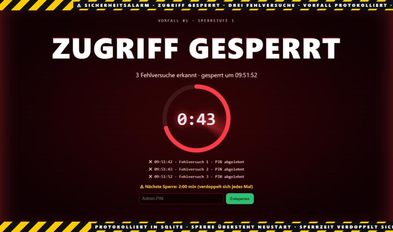
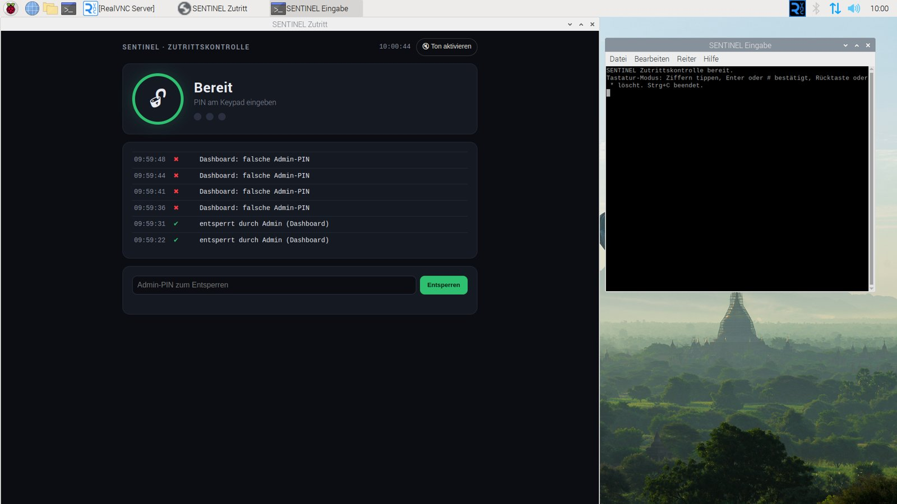
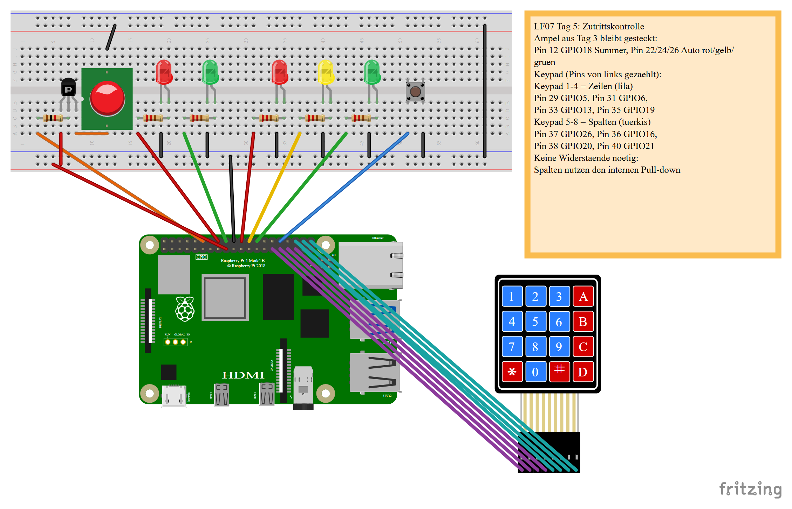

<p align="right"><a href="README.md">English</a> · <a href="README.de.md">Deutsch</a></p>

# Übung Tag 5: Zutrittskontrolle mit Keypad und Datenbank



Am 4x4-Keypad wird eine PIN eingegeben. Ist sie richtig, leuchtet die grüne Ampel-LED drei Sekunden („Tür offen“) und der Summer piept zweimal. Nach drei falschen PINs ist das Keypad gesperrt, zuerst für 60 Sekunden. Jede weitere Sperre dauert doppelt so lange, bis höchstens 15 Minuten, so wie man es vom Handy kennt. Jeder Versuch landet mit Uhrzeit in einer SQLite-Datenbank. Ein Live-Dashboard im Browser zeigt den Zustand, auch am Handy. Ein Admin kann die Sperre dort aus der Ferne aufheben.

Die Übung ist die Grundlage für SENTINEL-Projekt 05 (lokale Zutrittskontrolle) und 06 (Prüfung gegen eine Datenbank).

## Alarm-Show im Dashboard

Das Dashboard reagiert auf jedes Ereignis, das im Protokoll ankommt. Es fragt den Pi zweimal pro Sekunde ab und vergleicht mit der letzten Antwort.

| Ereignis | Was im Browser passiert |
|---|---|
| richtige PIN | grünes Vollbild „ZUTRITT GEWÄHRT“ mit Namen, Dreiklang, Ansage „Willkommen, Admin“ |
| 1. und 2. falsche PIN | Karte wackelt, gelber Punkt springt auf, Meldungsband „Fehlversuch 2 von 3“, Brummton; vor dem letzten Versuch warnt eine Ansage |
| 3. falsche PIN | Bildschirm blitzt rot und bebt, Sirene, rotes Vollbild mit Absperrband, Glitch-Schrift „ZUGRIFF GESPERRT“, Vorfall-Nummer, ablaufender Countdown-Ring mit Radar, die drei Fehlversuche mit Uhrzeit, Warnung zur nächsten (doppelt so langen) Sperre, Ansage „Achtung. Drei Fehlversuche. Zugriff gesperrt …“ |
| Sperre läuft ab | grünes Bild „SPERRE ABGELAUFEN“, Ansage |
| Admin entsperrt | grünes Bild „VOM ADMIN ENTSPERRT“, Ansage; das Admin-Feld gibt es auch direkt im Alarm-Bildschirm |

Ton und Sprache kommen aus dem Browser selbst (Web Audio und Sprachausgabe), es wird nichts installiert. Browser spielen Ton erst nach einem Klick ab. Deshalb vor der Vorführung oben rechts einmal auf „Ton aktivieren“ klicken. Wer im Betriebssystem „weniger Bewegung“ eingestellt hat, bekommt die Seite ohne Wackel- und Glitch-Effekte.


### Vorführung in 2 Minuten

1. Pi starten, in zwei SSH-Fenstern `python3 dashboard.py` und `python3 zutritt.py --tastatur` starten (mit Keypad ohne `--tastatur`).
2. Am Beamer `http://<IP-des-Pi>:5000` öffnen, F11 für Vollbild, „Ton aktivieren“ klicken.
3. Richtige PIN tippen: grünes Bild und die grüne Ampel-LED.
4. Dreimal falsch tippen: Sirene, Alarm-Bildschirm, rote LED dauerhaft an.
5. Pi-Stecker ziehen und wieder einstecken: Die Sperre ist immer noch da (sie steht in der Datenbank).
6. Admin-PIN im Alarm-Bildschirm eingeben: „VOM ADMIN ENTSPERRT“.

### Vorführung direkt auf dem Pi (RealVNC Viewer)

Der Pi 400 hat einen eigenen Desktop. Über den RealVNC Viewer sieht man ihn auf dem Notebook und am Beamer, und genau dort läuft die Vorführung dann auch: Dashboard links, Eingabe-Fenster rechts.



1. Einmalig auf dem Pi einrichten: `bash vorfuehrung.sh einrichten`. Das legt das Desktop-Symbol „SENTINEL Vorführung“ an und eine Fensterregel, die das Eingabe-Fenster rechts in den Vordergrund setzt.
2. Im RealVNC Viewer auf das Symbol „SENTINEL Vorführung“ doppelklicken. Das Skript startet das Dashboard (falls es nicht schon läuft), öffnet es als App-Fenster ohne Adressleiste und daneben das Eingabe-Fenster.
3. Ins Eingabe-Fenster klicken und die PIN tippen. Die Tastatur des Notebooks geht über VNC an den Pi, als säße man an der Pi-400-Tastatur.

RealVNC überträgt keinen Ton. Wer Sirene und Sprachansage im Raum hören will, öffnet das Dashboard zusätzlich im Browser des Notebooks (`http://<IP-des-Pi>:5000`) und klickt dort „Ton aktivieren“. Beide Ansichten laufen gleichzeitig und zeigen dasselbe.

## Warum die Datenbank wichtig ist

Würde das Programm die Fehlversuche nur in einer Variablen zählen, könnte man die Sperre einfach umgehen: Stecker ziehen, neu starten, Zähler steht wieder auf 0. Deshalb stehen Zähler und Sperrzeit in der Tabelle `sperre`. Nach einem Neustart liest das Programm sie wieder ein, und die Sperre läuft weiter.

| Tabelle | Inhalt |
|---|---|
| `benutzer` | Name, Salt, PIN-Hash, Rolle (`nutzer` oder `admin`), aktiv |
| `versuche` | Zeitpunkt, Erfolg ja/nein, Benutzer, Hinweis (z. B. „GESPERRT für 60 s“) |
| `sperre` | eine Zeile: aktuelle Fehlversuche, Sperrstufe, gesperrt bis (Unix-Zeit) |

Die PIN steht nie im Klartext in der Datenbank. Gespeichert wird ein Hash aus PIN und einem zufälligen Salt (PBKDF2-SHA256 mit 100.000 Runden). Wer die Datei kopiert, sieht also nicht, wie die PIN lautet. Durchprobieren aller 10.000 vierstelligen PINs dauert durch die vielen Runden spürbar länger. In Projekt 06 kommt Argon2 dazu.

## Pinbelegung

Die Ampel aus [Tag 3](../tag03-fussgaengerampel/) bleibt gesteckt. Das Keypad kommt mit 8 Kabeln direkt an die freien Pins am Ende der Leiste. Widerstände braucht das Keypad nicht, weil die Spalten den internen Pull-down-Widerstand des Pi benutzen.

| Keypad-Pin (von links) | Bedeutung | GPIO | Physischer Pin |
|:-:|---|---|:-:|
| 1 | Zeile 1 (1 2 3 A) | GPIO5 | 29 |
| 2 | Zeile 2 (4 5 6 B) | GPIO6 | 31 |
| 3 | Zeile 3 (7 8 9 C) | GPIO13 | 33 |
| 4 | Zeile 4 (* 0 # D) | GPIO19 | 35 |
| 5 | Spalte 1 (1 4 7 *) | GPIO26 | 37 |
| 6 | Spalte 2 (2 5 8 0) | GPIO16 | 36 |
| 7 | Spalte 3 (3 6 9 #) | GPIO20 | 38 |
| 8 | Spalte 4 (A B C D) | GPIO21 | 40 |

Anzeige: Auto-Rot GPIO25 (gesperrt, falsche PIN), Auto-Gelb GPIO8 (blinkt bei jedem Tastendruck), Auto-Grün GPIO7 (Tür offen), Summer GPIO18 über den PNP-Transistor.



Fritzing-Datei: [schaltplan/05-zutritt.fzz](schaltplan/05-zutritt.fzz). Das Keypad-Bauteil steckt in der Datei mit drin, sie öffnet also auch auf einem Rechner ohne installiertes Keypad.

## So liest der Pi 16 Tasten mit 8 Leitungen

Die Tasten liegen in einem Gitter aus 4 Zeilen und 4 Spalten. Eine Taste verbindet beim Drücken genau eine Zeile mit einer Spalte. Das Programm schaltet die Zeilen nacheinander auf HIGH und schaut dabei auf die Spalten. Ist gerade Zeile 2 an und Spalte 2 meldet HIGH, dann ist die 5 gedrückt. Ein ganzer Durchlauf dauert wenige Millisekunden und wiederholt sich alle 20 ms. Eine Taste zählt erst wieder, wenn sie losgelassen wurde. So wird aus einem langen Druck keine Zifferkette.

## Bedienung

- Ziffern tippen, `#` bestätigt, `*` löscht die Eingabe.
- Eine angefangene Eingabe verfällt nach 10 Sekunden ohne Taste.
- Während einer Sperre werden alle Tasten ignoriert, die rote LED leuchtet dauerhaft.

## Testen auf dem Pi

Die Tests bauen aufeinander auf. Jede Stufe prüft etwas mehr Hardware.

### Stufe 1: automatischer Test ohne Hardware

```bash
cd ~/lf07-cyber-physische-systeme/uebungen/tag05-zutrittskontrolle
python3 test_zutritt.py
```

Der Test nutzt simulierte Pins und eine eigene Test-Datenbank. Er prüft 18 Punkte, unter anderem: richtige PIN öffnet, dritte falsche PIN sperrt, Sperre übersteht einen Neustart, zweite Sperre ist doppelt so lang, Admin entsperrt per Dashboard, PIN steht nicht im Klartext in der Datei. Am Ende muss „Alle Tests bestanden.“ stehen.

### Stufe 2: Benutzer anlegen

```bash
python3 verwalten.py neu Phil
python3 verwalten.py neu Admin --admin
python3 verwalten.py liste
```

Die PIN wird verdeckt abgefragt (4 bis 8 Ziffern). Der Admin braucht eine eigene PIN, mit der er im Dashboard entsperren kann.

### Stufe 3: ohne Keypad, die Tastatur wird zum Keypad

```bash
python3 zutritt.py --tastatur
```

Ohne Keypad übernimmt die Tastatur seine Rolle. Das klappt mit der Tastatur des Pi 400 selbst (Terminal am Pi oder über VNC) und genauso mit dem Notebook über SSH. Jede Taste wirkt sofort wie ein Druck auf das Keypad, Enter gibt es nicht extra:

| Tastatur | wirkt wie Keypad |
|---|---|
| Ziffern 0 bis 9 | Ziffern |
| Enter oder `#` | `#` (bestätigen) |
| Rücktaste oder `*` | `*` (löschen) |
| A bis D | A bis D (ohne Funktion) |

LEDs und Summer an der Ampel reagieren dabei echt, und das Dashboard zeigt alles live. Damit lässt sich die ganze Zutrittskontrolle vorführen, ohne dass ein Keypad angeschlossen ist. Kommt das Keypad dazu, ändert sich am Programm nichts, man startet es nur ohne `--tastatur`.

### Stufe 4: Keypad-Verkabelung prüfen

```bash
python3 zutritt.py --tasten-test
```

Jede gedrückte Taste wird angezeigt. Alle 16 Tasten einmal drücken. Kommt bei einer Zeile oder Spalte nichts an, sitzt das passende Kabel nicht. Erscheinen falsche Ziffern, sind die Kabel in falscher Reihenfolge oder der Stecker ist andersherum aufgesteckt.

### Stufe 5: alles zusammen, mit Dashboard

Zwei SSH-Fenster öffnen.

```bash
# Fenster 1
python3 dashboard.py
# Fenster 2 (mit Keypad; ohne Keypad: python3 zutritt.py --tastatur)
python3 zutritt.py
```

Im Browser `http://<IP-des-Pi>:5000` öffnen, im Heimnetz oder über Tailscale, auch am Handy. Dann am Keypad (oder an der Tastatur) testen:

| Nr. | Aktion | Erwartet | Ergebnis |
|:-:|---|---|:-:|
| 1 | richtige PIN + `#` | grün 3 s, zwei Pieptöne, Dashboard zeigt ✔ | offen |
| 2 | `12*` und dann richtige PIN + `#` | `*` löscht, danach öffnet es | offen |
| 3 | falsche PIN + `#` | langer Ton, rot blinkt, ein gelber Punkt im Dashboard | offen |
| 4 | noch zweimal falsch | Alarm, rot dauerhaft, Dashboard zeigt GESPERRT mit Countdown | offen |
| 5 | richtige PIN während der Sperre | wird ignoriert | offen |
| 6 | `Strg+C`, Programm neu starten | Sperre läuft weiter | offen |
| 7 | im Dashboard Admin-PIN eingeben | entsperrt, rote LED geht aus | offen |
| 8 | Protokoll ansehen: `python3 verwalten.py protokoll` | alle Versuche mit Uhrzeit | offen |

## Dateien

| Datei | Aufgabe |
|---|---|
| `zutritt.py` | Keypad lesen, PIN prüfen, LEDs und Summer steuern |
| `zutritt_db.py` | alles rund um die Datenbank: Tabellen, Hash, Sperre, Protokoll |
| `dashboard.py` | Live-Dashboard mit Flask auf Port 5000 |
| `dashboard.html` | die Webseite des Dashboards mit Alarm-Show (HTML, CSS, JavaScript) |
| `verwalten.py` | Benutzer anlegen, Protokoll, Status, entsperren |
| `vorfuehrung.sh` | startet die Vorführung auf dem Pi-Desktop, `einrichten` legt Symbol und Fensterregel an |
| `test_zutritt.py` | automatischer Test mit simulierten Pins |

Die Datenbank `zutritt.db` entsteht beim ersten Start im selben Ordner. Sie steht in `.gitignore` und landet nicht auf GitHub, weil sie die PIN-Hashes enthält.

Jede Code-Zeile hat einen deutschen Kommentar, der erklärt, was sie tut.

## Grenzen

- Das Dashboard hat keine Anmeldung und läuft unverschlüsselt (HTTP). Es gehört nur ins Heimnetz oder ins Tailscale-Netz, nie offen ins Internet.
- Eine „Tür“ gibt es noch nicht, nur die grüne LED. In Projekt 05 kommt ein Servo als Schloss dazu.
