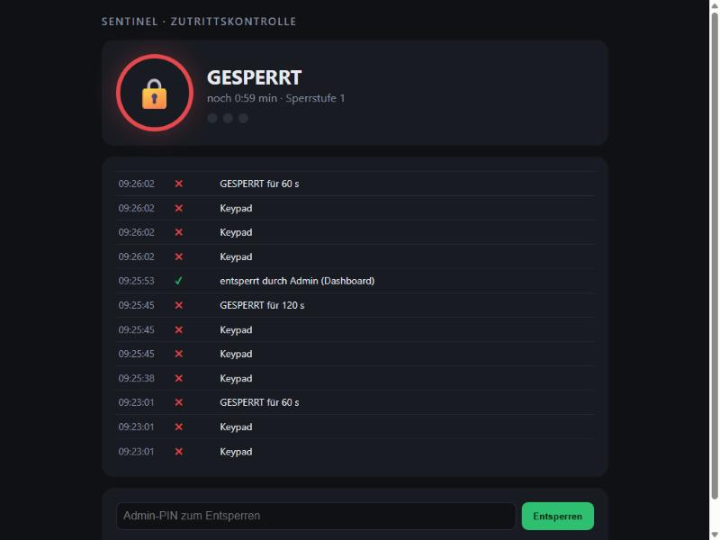
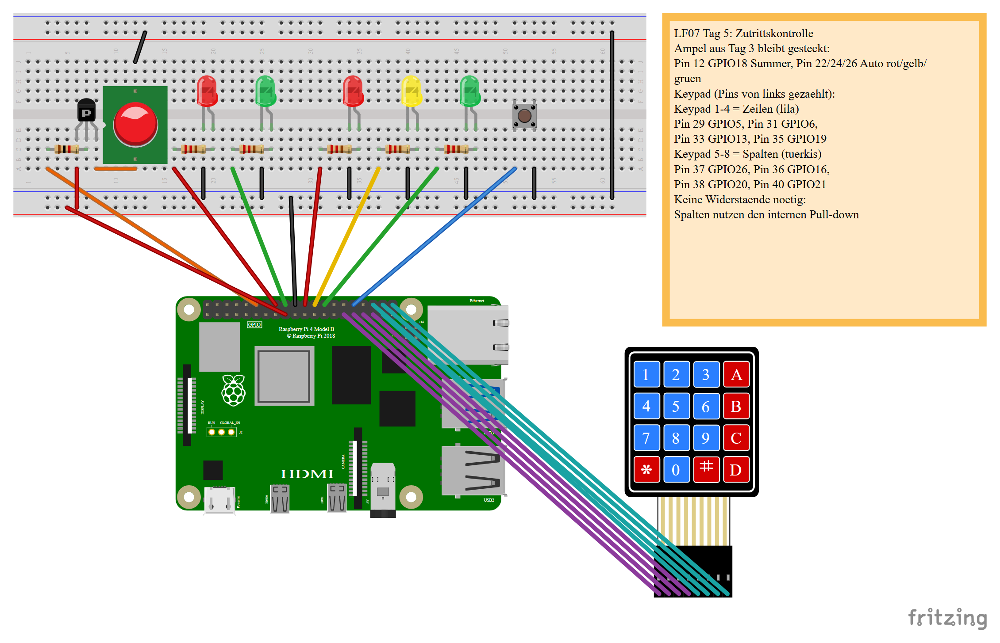

<p align="right"><a href="README.md">English</a> · <a href="README.de.md">Deutsch</a></p>

# Exercise day 5: access control with keypad and database



A PIN is typed on a 4x4 membrane keypad. If it is correct, the green traffic light LED stays on for three seconds ("door open") and the buzzer beeps twice. After three wrong PINs the keypad locks for 60 seconds. Each further lockout doubles, up to 15 minutes. Every attempt is stored with a timestamp in a SQLite database. A live dashboard in the browser shows the state, also on a phone, and an admin can lift the lockout from there.

This exercise is the base for SENTINEL project 05 (local access control) and 06 (PIN check against a database).

## Why a database

If the program only counted failures in a variable, a reboot would reset the counter and defeat the lockout. The counter and the lockout end time are stored in the `sperre` table, so a lockout survives a restart.

PINs are never stored in plain text: the database holds a salted PBKDF2-SHA256 hash with 100,000 rounds.

## Pinout

The traffic light from [day 3](../tag03-fussgaengerampel/) stays on the breadboard. The keypad connects with 8 jumper wires to the free pins at the end of the header. No resistors are needed because the column inputs use the Pi's internal pull-down.

| Keypad pin (from left) | Function | GPIO | Physical pin |
|:-:|---|---|:-:|
| 1 to 4 | rows | GPIO5, 6, 13, 19 | 29, 31, 33, 35 |
| 5 to 8 | columns | GPIO26, 16, 20, 21 | 37, 36, 38, 40 |

Output: red GPIO25 (locked / wrong PIN), yellow GPIO8 (key press), green GPIO7 (door open), buzzer GPIO18 through the PNP transistor.



Fritzing file: [schaltplan/05-zutritt.fzz](schaltplan/05-zutritt.fzz). The keypad part is embedded in the file.

## Run and test

```bash
cd ~/lf07-cyber-physische-systeme/uebungen/tag05-zutrittskontrolle
python3 test_zutritt.py            # 17 checks with simulated pins, no hardware needed
python3 verwalten.py neu Phil      # add a user, PIN is asked hidden
python3 verwalten.py neu Admin --admin
python3 zutritt.py --tastatur      # type the PIN over SSH, LEDs and buzzer are real
python3 zutritt.py --tasten-test   # check the keypad wiring key by key
python3 dashboard.py               # live dashboard on http://<pi-ip>:5000
python3 zutritt.py                 # the real thing
```

Keys: digits, `#` confirms, `*` clears. The full step-by-step test plan is in the [German README](README.de.md).

## Limits

The dashboard has no login and uses plain HTTP. Keep it on the home network or Tailscale only. There is no real lock yet; project 05 adds a servo.
